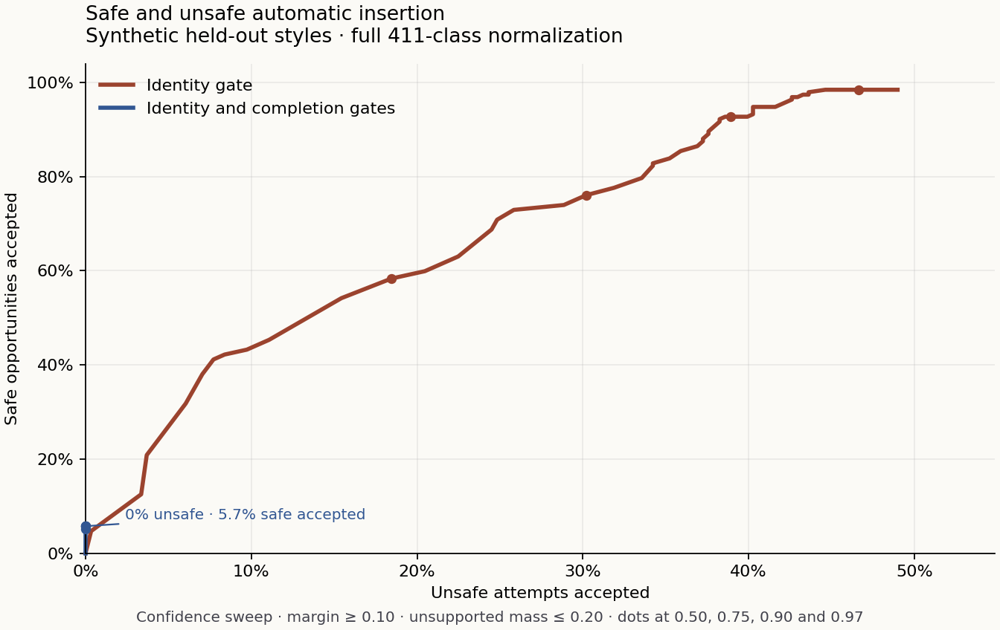
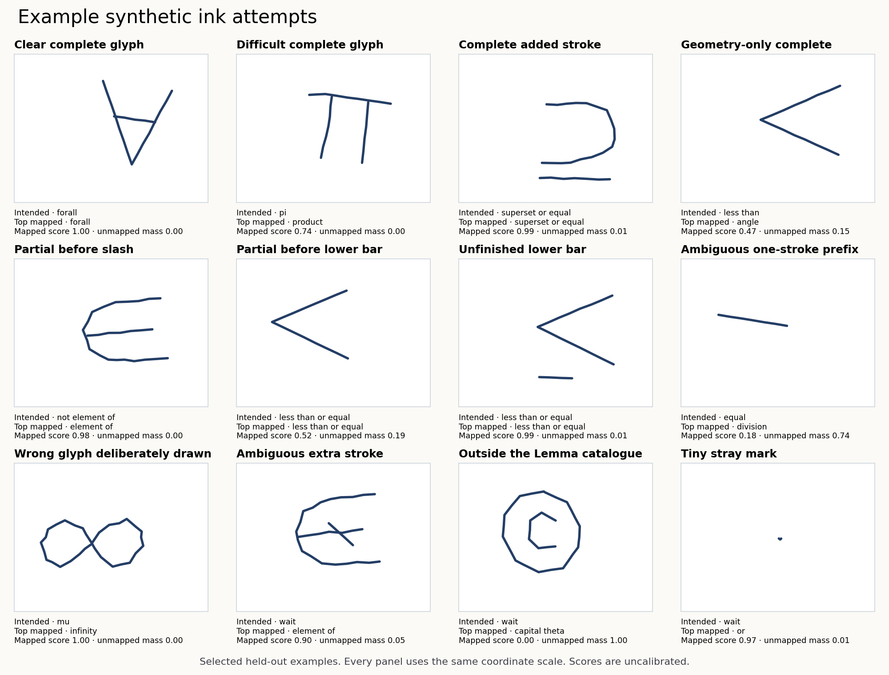

# Tutor ink simulation

Three classifier candidates retained the correct symbol on all 200 held-out complete traces with an exact classifier class. Five and seven yielded the same recall. Three **Could become** choices included the intended longer symbol on 53 of 100 partial traces. Five yielded the same recall and 20 additional proposals. The compact strip uses three choices per group. A glyph eligible for both groups appears once, under **Could become**.

At a representative threshold, an identity-only rule would have inserted the wrong glyph or inserted too early on 116 of 490 held-out attempts. Requiring independent completion reduced that to zero observed errors across 11 hypothetical insertions. The beta requires an explicit selection for every result. Automatic insertion waits for a calibration artifact based on genuine writing and tested release devices.

A separate run adds alternate stroke prototypes and writing mechanics and tests the final candidate strip. [Human-like synthetic stress test](humanlike-stress/README.md)

## Corpus and worker

The corpus covers 49 hand-annotated stroke prototypes. Each split transforms all prototypes into 10 synthetic styles using independently seeded rotation, shear, aspect ratio, position, shape wobble, resampling, stroke order and stroke direction. The tuning seed is `0x24c8a225` and the held-out style seed is `0x983a887e`. Both splits share prototypes. These are controlled repeatable traces, so results describe this corpus and do not estimate accuracy across writers or devices. [Fixture generator](../../../../scripts/v7/tutor-ink-fixtures.ts)

| Attempt category | Per split | Label |
| --- | ---: | --- |
| Complete | 240 | Expected exact symbol. Four of the 24 prototypes lack an exact model class. |
| Partial | 100 | Intended extension, already drawn shorter glyph where applicable, and plausible alternatives. |
| Ambiguous | 40 | Altered relations or quantifiers with no safe automatic choice. |
| Unsupported | 50 | Symbols outside the Lemma catalogue and scribbles with no safe automatic choice. |
| Wrong glyph drawn deliberately | 30 | Annotated drawn glyph and separate intended glyph. Correctly reading the drawn glyph still fails the intended edit. |
| Empty or stray ink | 30 | Empty pad, point or tiny flicks that should never trigger insertion. |

Headless Chromium `153.0.8010.12` ran the production worker and the packaged Detypify ONNX model locally. The run used asset set `detypify-0.3.0-lemma-v1` and preprocessing `detypify-canvas-9px-v1`. The real worker returned 411 raw logits for 470 attempts per split. The other 20 per split were empty or point-only strokes that abstained at preprocessing. Softmax used all 411 classes. Aliases contribute to a canonical symbol and the 275 unmapped classes retain their probability mass. Scores are uncalibrated. The recorded worker and model hashes identify the inputs. [Run summary](summary.json) · [Model manifest](../../../../public/models/tutor-symbols/detypify-0.3.0-lemma-v1/manifest.json)

Among scored held-out attempts, mean unmapped mass was 91.1% for unsupported shapes, 21.1% for partial, 13.0% for ambiguous, 7.9% for complete, 3.1% for deliberately wrong glyphs and 46.9% for tiny flicks. A confidently recognized wrong glyph can still conflict with the writer’s intended edit. Retaining unsupported mass helps abstain on unsupported shapes and the independent completion gate protects unfinished strokes.

## Candidate strip

The geometry-first recall column includes all 240 complete held-out attempts and uses the original explicit geometry threshold of 0.94. The simulated order matched the reference candidate policy through its five-candidate cap. Seven extends that order for comparison. The model-only column covers the 200 attempts with exact classes and applies the requested rank budget before the visible cap. [Per-attempt data](attempts.csv)

| Rank budget | Model-only complete recall | Geometry-first complete recall | Intended partial extension | Unannotated extension proposals |
| ---: | ---: | ---: | ---: | ---: |
| 1 | 192/200 | 196/240 | 45/100 | 17 of 64 |
| 2 | — | — | 49/100 | 42 of 93 |
| 3 | 200/200 | 204/240 | 53/100 | 57 of 112 |
| 5 | 200/200 | 204/240 | 53/100 | 72 of 132 |
| 7 | 200/200 | 204/240 | — | — |

Three is the smallest tested classifier budget with full recall for model-supported prototypes in both splits. Moving from two to three **Could become** choices recovered four intended extensions on held-out partial ink and three on tuning ink. Unannotated proposals may be valid interpretations outside the hand-labeled list. For 80 held-out partial attempts with a named shorter glyph, the reference five-candidate policy offered that glyph 41 times. The shorter glyph is a valid explicit choice while a compatible longer glyph remains unfinished. The strip reserves the distinct extensions on the right first, then shows up to three remaining distinct matches on the left. The union of the two groups gives the available choices. This order keeps all 53 intended extension suggestions in **Could become**. Giving **Matches** priority would leave 29 in **Could become** and put the other 24 under **Matches**.

Detypify lacks exact classes for `<`, `>`, `=` and `≠`. The original geometry matcher recovered one of 10 held-out traces per glyph. The full symbol picker covers all four glyphs.

We compared 0.94, 0.90 and 0.86 similarity floors for those four explicitly selected shapes on the tuning split. The 0.86 floor recovered 14 of 40 complete traces at the existing 0.07 gap, up from two at 0.94, with zero incorrect extra geometry choices on the annotated tuning traces. The beta uses 0.86 and 0.07 for that explicit branch. A replay reused the actual model ranks and compared both geometry settings on every frozen trace. [Geometry sweep and replay](geometry-sweep.json)

| Held-out displayed result with three choices per group | Original 0.94 | Beta 0.86 |
| --- | ---: | ---: |
| Correct match on complete ink | 204/240 | 216/240 |
| Correct match on the four geometry-only symbols | 4/40 | 16/40 |
| Valid shorter match while the intended symbol is unfinished | 41/80 | 50/80 |
| Intended longer choice on a partial trace | 53/100 | 53/100 |

The replay found no wrong or unannotated extra geometry choices at the beta floor on held-out traces. Exact geometry suggestions still require a tap. Independent completion and the finished-model gate produced identical decisions across all 980 traces. The full classifier normalization and completion policy are independent of the three-per-group display limit.

## Simulated insertion rules

An eligible attempt is a complete glyph with the correct top-ranked model identity. Each split has 192 eligible and 298 ineligible attempts. Ineligible attempts include complete glyphs with the wrong leader, intentionally incomplete ink, ambiguous ink, unsupported ink, wrong intended glyphs and stray or empty ink. Both hypothetical rules require a minimum leading mass, a minimum margin over the second ranked mapped candidate and a maximum unmapped mass. The combined rule also requires a `finished` result from the existing completion policy and a leading model candidate. Exact geometry choices always require selection.

The two plots sweep the leading-mass floor with margin ≥ 0.10 and unmapped mass ≤ 0.20 under the original 0.94 geometry setting. ROC horizontal position is the fraction of ineligible attempts accepted. Vertical position is the fraction of eligible attempts accepted. Precision–coverage uses the fraction of all attempts accepted and the fraction of accepted attempts that were correct. The curves show only operating points possible with those fixed gates. [ROC curve](roc.png) · [Precision–coverage curve](precision-coverage.png) · [ROC data](roc-points.csv)



| Held-out rule at floor 0.75, margin 0.15, unmapped cap 0.20 | Correct | Incorrect | Precision | Coverage |
| --- | ---: | ---: | ---: | ---: |
| Identity | 178 | 116 | 60.5% | 60.0% |
| Identity and completion | 11 | 0 | 100% observed | 2.24% |

The 116 identity-only errors comprise seven wrong matches on complete glyphs, 60 premature partial insertions, 18 ambiguous traces, 29 deliberately wrong intended glyphs and two stray flicks. An identity floor of 0.999 at margin 0.10 and unmapped cap 0.20 still made 11 errors, including one premature partial insertion. The combined rule at the representative point accepted 5.73% of eligible attempts and 4.58% of complete attempts. Under an illustrative value of one action saved per correct insertion and five actions lost per wrong insertion, the representative results are −402 for identity alone and +11 for both gates. This is a sensitivity example rather than a measurement of correction time.

The 832-row grid varies leading mass, margin, unmapped mass and gate. A tuning-only rule selected the zero-error combined point with the most correct acceptances, breaking ties in favor of stricter numerical thresholds. This selected 0.97 leading mass, 0.35 margin and 0.05 unmapped cap and accepted 10 correct attempts with zero observed errors on both splits. Even 0 errors in 11 independent trials would permit a one-sided 95% binomial upper error bound of 23.8%. Shared synthetic prototypes and style transforms make this bound illustrative only. An idle pause cannot resolve whether a recognizably shorter glyph is finished. Unresolved strokes wait for another stroke or an explicit choice. [Threshold grid](sweep.csv) · [Selected operating point](summary.json)

## Example traces

Each panel shares the same coordinate scale. The example selection includes a complete geometry-only glyph, difficult completed variants, unfinished relation symbols and a well-formed glyph deliberately different from the intended target. [Full-resolution examples](examples.png)



## Reproduce

Run with the repository root as the working directory, a production Vite build served locally under `/lemma/`, the matching `dist` directory, and Playwright Chromium installed. Set `PLAYWRIGHT_BROWSERS_PATH` if using a shared browser download cache. Use Node.js 24 and Python with Matplotlib for the figures. `elapsedMs` and `setupMsDiagnostic` are desktop diagnostics from this concurrent environment.

```sh
./node_modules/.bin/tsx scripts/v7/simulate-tutor-ink.ts \
  --url http://127.0.0.1:4182/lemma/ --dist dist --output /tmp/lemma-ink-simulation
python3 scripts/v7/plot-tutor-ink-simulation.py /tmp/lemma-ink-simulation
```

The driver checks worker replies and policy ranks. Its browser context requests only same-origin assets. A new run imports the current explicit geometry floor. To reproduce the original snapshot, use 0.94 for the `exactMatches` similarity check in a disposable copy. The archived per-attempt results retain the original setting and the geometry replay records the measured effect of the final floor. [Simulation driver](../../../../scripts/v7/simulate-tutor-ink.ts) · [Figure script](../../../../scripts/v7/plot-tutor-ink-simulation.py)
