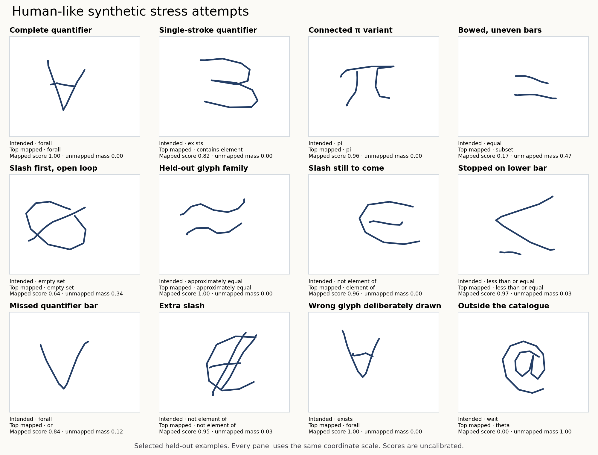
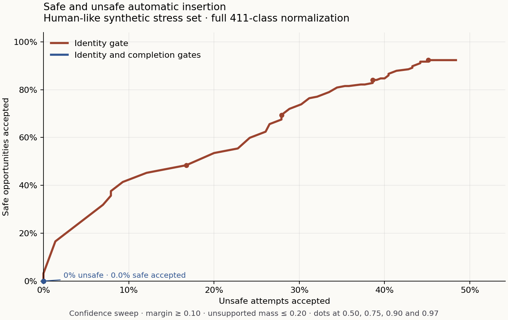

# Human-like synthetic ink stress test

On 372 held-out attempts, the current strip offered the intended complete symbol on **172 of 204 (84.3%)**. Each of the 168 complete traces with an exact model class included its target in the strip. The four geometry-only symbols accounted for all 32 misses. **Could become** offered the intended symbol on **22 of 66 partial traces (33.3%)**. The intended symbol appeared somewhere in the strip on 43 of 66 partial traces, and a valid shorter choice appeared in **Matches** on 25 of the 54 partial traces with an annotated shorter glyph.

The first simulation had 216/240 complete targets and 53/100 intended extensions with the same final display and geometry settings. Differences reflect the two test corpora. This stress set adds plausible stroke variants and writing mechanics with controlled labels. Each rate describes these synthetic traces on desktop Chromium. [Original simulation](../README.md)

## Corpus

Six tuning styles and six disjoint test styles generate 696 traces. The 48 shared prototypes include 24 complete glyphs and examples of pending, missed, extra, overwritten, unsupported and stray ink. Six additional complete prototypes appear in tuning only. Fourteen test-only prototypes include 10 complete, two partial and two ambiguous cases, with `≈`, `∂` and `∥` appearing only in the test split. Test-only topology includes a continuous rounded `∃`, a one-lift `π`, a slash-first open `∅`, bowed unequal bars and an off-center shorter inequality bar. The `native-` prefix in the CSV names the shared synthetic complete shapes. [Prototype and style generator](../../../../../scripts/v7/tutor-ink-humanlike-fixtures.ts)

| Trace category | Tuning | Held-out styles | Test-only prototypes within held-out styles |
| --- | ---: | ---: | ---: |
| Complete glyph | 180 | 204 | 60 |
| Partial with a pending mark | 54 | 66 | 12 |
| Missed, extra or overwritten stroke | 30 | 42 | 12 |
| Outside the catalogue | 24 | 24 | 0 |
| Deliberately drawn different glyph | 18 | 18 | 0 |
| Empty, touch point or stray flick | 18 | 18 | 0 |
| Total | 324 | 372 | 84 |

Hand-authored polylines supply alternate shapes, pen lifts and stroke order. Style profiles vary location, aspect, slant, bar length and curvature. Endpoints can overshoot and hook. Low-frequency positional drift acts across each stroke. Different path regions use different point density and intervals, including slower turns and pauses. The worker raster uses the spatial samples. Generated timestamps describe the gesture and do not measure touch hardware. There were zero clipped coordinates, at most four strokes per gesture and 105 points per stroke. The tuning seed was `0x8f32041d` and the test seed was `0xdad3a761`.

The intended glyph, observed shorter or deliberately different glyph, and plausible pending extensions are separate labels. A pending slash and a missed slash can have identical visible ink and different safe actions. Each partial trace stays partial even when the classifier confidently suggests a recognizable symbol. Unsupported, ambiguous and different-glyph traces are unsafe automatic choices under the annotations.



## Actual candidate strip

The run used the final production worker `inkRecognizer.worker-DqYPmRlt.js` in Chromium `153.0.8010.12` and identical Detypify weights to the first simulation. The worker returned 411 logits on 312 tuning traces and 360 test traces. Empty and point-only inputs abstained. Softmax includes the full inventory, with unmapped probability mass preserved. The 0.86 explicit geometry floor and 0.07 separation were frozen before the run. The display takes three distinct **Could become** glyphs first, then up to three distinct **Matches** from the policy's first five candidates. The sweep ran during screenshot capture, so elapsed times are diagnostic only. [Run summary and asset checksums](summary.json) · [Per-attempt data](attempts.csv)

| Held-out display result | All test traces in cohort | Test-only prototypes |
| --- | ---: | ---: |
| Complete target in Matches or Could become | 172/204 (84.3%) | 50/60 (83.3%) |
| Complete target with exact model class in either group | 168/168 (100%) | 48/48 (100%) |
| Complete geometry-only target in Matches | 4/36 (11.1%) | 2/12 (16.7%) |
| Intended longer glyph in Could become | 22/66 (33.3%) | 2/12 (16.7%) |
| Intended longer glyph anywhere in strip | 43/66 (65.2%) | 3/12 (25.0%) |
| Valid shorter glyph in Matches | 25/54 (46.3%) | 0/6 (0%) |

The model ranked 157/168 exact-class complete targets first and 168/168 in the top three. Five and seven also recalled 168/168. The geometry-only results were one of six `<`, zero of six `>`, one of 12 `=` and two of 12 `≠`. These four targets have no exact classifier class, so a larger model list cannot recover them. The full symbol picker covers them.

One, two and three extension slots recovered 17, 20 and 22 of 66 intended extensions. Five still recovered 22 and added six proposals. With three slots, 26 of 48 extension proposals had no annotation for the corresponding trace. The labels list known interpretations and are not exhaustive. Recovery varied by family. A pending `≠` after drawing `=` appeared in **Could become** on 5/6 shared-prototype traces, and a pending `≤` after drawing `<` appeared on 1/6. Slashed `=` before its second bar appeared on 2/6 test-only variants. [Per-fixture and per-style counts](summary.json)

## Insertion, waiting and comparison

The stress test has 157 eligible opportunities where a complete glyph's top model identity was correct and 215 unsafe attempts under the labels. The representative identity rule uses a leading mass of at least 0.75, margin of at least 0.15 and unmapped mass of at most 0.20. It would accept 215 attempts, with 132 correct and **83 errors**. Errors include 15 wrong complete classifications, 41 unfinished glyphs, seven ambiguous traces, one unsupported shape, 18 deliberately different drawn glyphs and one stray flick. That is 61.4% observed precision at 57.8% coverage. The combined rule waited on every attempt.

The 24 scored unsupported attempts had 70.3% mean unmapped mass and a 96.2% median. Mean unmapped mass was 49.3% for ambiguous traces, 22.3% for partial traces and 8.8% for complete traces. Deliberately drawing a different valid glyph had a mean of 0.06%. An unsupported-mass gate can catch some unfamiliar shapes. Intention and completion still require their own evidence.

The original tuning point of 0.97 leading mass, 0.35 margin and 0.05 unmapped cap also accepted zero under both gates. Of all 372 test attempts, the policy labeled two `finished`. Both were explicit geometry choices for `≠` and require a tap. The 832-row threshold grid found no combined acceptance in either split. Precision is undefined with zero acceptances. The stress set supports explicit selection and requiring independent completion evidence before evaluating any future automatic policy. The remaining gaps are exact-class coverage and completion evidence. [Threshold grid](sweep.csv) · [ROC points](roc-points.csv)



The ROC sweeps leading mass with a 0.10 minimum margin and a 0.20 maximum unmapped mass. The horizontal denominator is 215 unsafe attempts and the vertical denominator is 157 eligible attempts. The precision plot shows accepted correctness against coverage across all 372 attempts. [Precision–coverage plot](precision-coverage.png)

Use both synthetic sets for regression and a held-out real-writer set for release criteria. The higher-value model comparison covers unsupported exact glyphs, safe abstention across partial strokes and candidate recall at three. CPU, memory, touch behavior, sustained latency and offline cache behavior on a Snapdragon 4 Gen 4 phone with 6 GB RAM still need device measurements.

## Reproduce

From the repository root, serve the current production build under `/lemma/` and point the driver at the serving origin and corresponding `dist` directory. Use Playwright Chromium, Node.js 24 and Matplotlib.

```sh
./node_modules/.bin/tsx scripts/v7/simulate-tutor-ink.ts \
  --corpus humanlike --url http://127.0.0.1:4182/lemma/ --dist dist \
  --output /tmp/lemma-ink-humanlike
python3 scripts/v7/plot-tutor-ink-simulation.py /tmp/lemma-ink-humanlike
```
