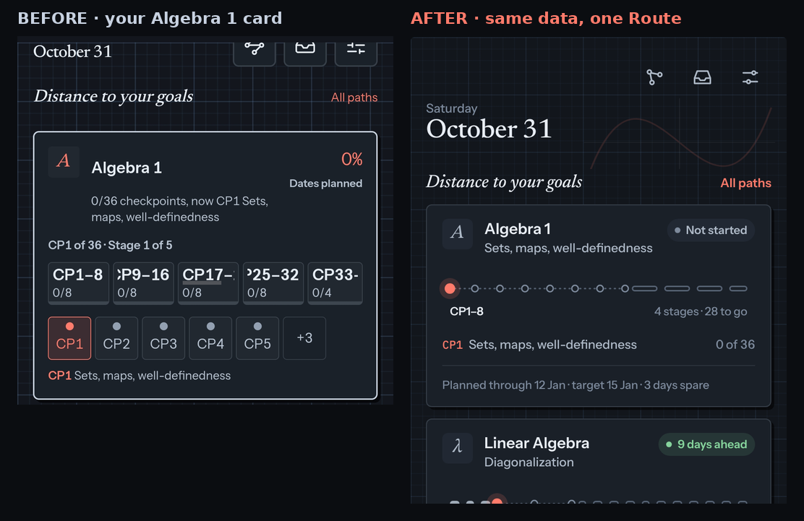
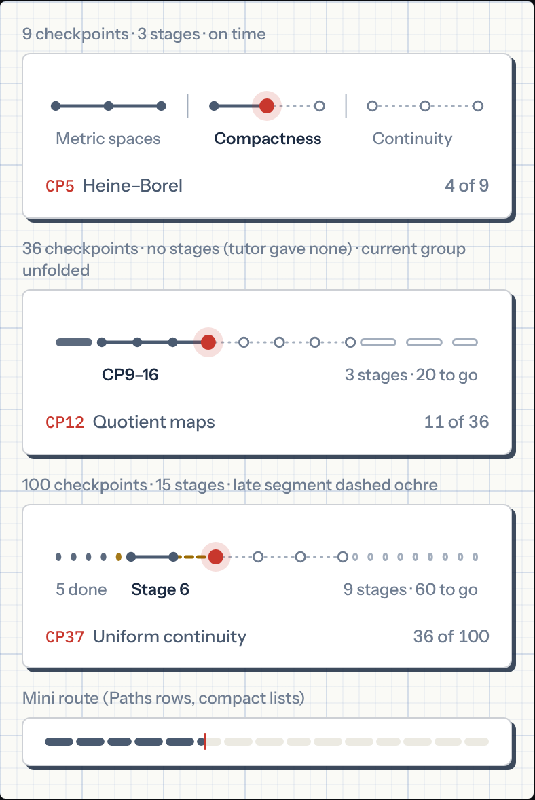
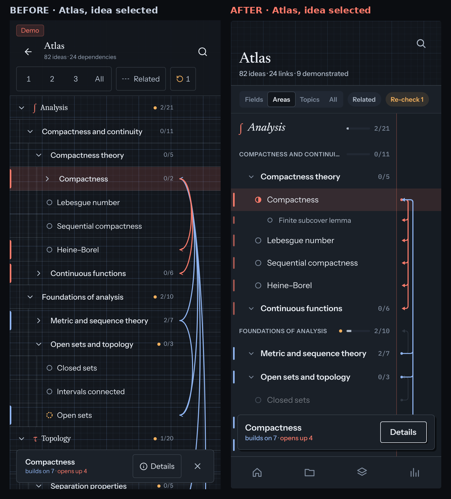
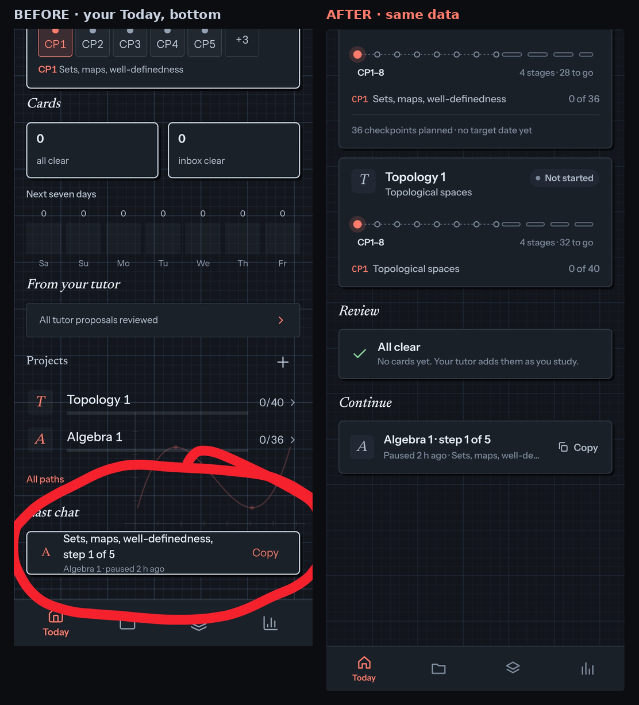

# Lemma v4 look: a quiet notebook (owner, 31 Oct 2026)

The owner's verdict on the live app (Algebra 1, 36 checkpoints, no stages): "the ugliest checkpoint presentation I have seen". This spec audits **every screen**, names the causes, and gives a plan to make the app calm and beautiful **without leaving the graph-paper identity** (v3 §1). It builds on `v3.md` and `stress.md`; where it changes an owner decision, §8 lists the change. **The owner approved this spec, §8 included, on 31 Oct 2026 at 13:59 IST.** Where it differs from `v3.md`, this spec wins.

**How the audit was done.** Current `main` (73c35b2) built and run in demo mode at 393 × 873 (2×), night and day, with the default and `?demo=stress` profiles; every route in `src/app/routes.tsx` plus the Atlas selection, details and "All" states. Contact sheets: `docs/design/v4/audit/`. Mockups of the target: `docs/design/v4/` (dates in the mockups are illustrative).



## 1. What makes it ugly (systemic causes)

Fixing screens one by one will not work; the same six causes appear on every screen.

1. **The accent means "danger".** Night `--accent` is `#FF7B6B` and `--bad` is `#FF8A8A` (ΔE2000 6.6); day `#C8372D` and `#B3261E` (ΔE 5.7). On a 2 px line these cannot be told apart. The same red marks the current station, late track, percentages, "Qualifier:", links, badges, checkboxes, primary buttons and "Again". So:
   - every screen looks like an error state;
   - the Metro legend shows **On time and Late in the same colour** (project page);
   - "0 %" in big red reads as an alarm on a plan that has not started yet (owner's screenshot).
2. **Box inside box inside box.** At night every surface gets a bright 1.5 px `#C9D3E0` border and a hard offset shadow (`graph.css` `:is(.card,.slab,.tile)`, `.ui-chip`, `.ui-button`). Labels (`CP4`, `In progress`, `Compactness and continuity`) look exactly like buttons. The stage Metro is three levels deep: card › stage button › clipped text.
3. **Everything is said three times, at the same weight.** The Today goal card names the current checkpoint three times ("now CP1 Sets…", "CP1 of 36 · Stage 1 of 5", "CP1 Sets…"). The project page shows the title twice and CP4 four times. Seven metadata lines share one size and grey, so nothing leads.
4. **No type system.** Section headings switch between Newsreader italic ("Distance to your goals"), Newsreader upright ("Projects", "Apps"), small sans ("Next seven days"), uppercase serif ("OCTOBER 2026") and uppercase sans ("CP4 · IN PROGRESS"). IBM Plex Mono is used for prose ("Due now", "18 h 40 m", "33 d"), which reads like a terminal. EB Garamond is downloaded on every load and never used.
5. **The background drawing sits on top of the content.** `GraphSketch` is `position: fixed` above the tab bar, so as you scroll the curve slices through charts, headings and lists. Examples: the owner's screenshot (through "Next seven days" and "From your tutor"), "Learning curve" between Paths groups, "Normal density" between Insights cards, the unit circle between Settings cards. At night the 60 px grid at 15 % also shows through every transparent list (Atlas, sessions, cards), making a plaid with the row hairlines.
6. **Data that outgrows its form gets clipped, not reshaped.** The stage Metro is implemented as two horizontally scrolling rails of 44 px buttons (`ProjectTimeline.tsx` lines 103–169), not the single line that stress.md A1 specified. Stage names are cut mid-glyph ("Stage 12" → "Stage", "CP9–16" → "ꟼ9–16") with no fade. This is the owner's screenshot and audit #509.

## 2. Design direction: "a quiet notebook"

The idea: a mathematician's engineering pad. **Paper** for content, **ink** for marks, and **one red pencil** for "you are here". Everything else is graphite.

### 2a. Colour roles (tokens in `scripts/make-themes.ts` → `src/styles/themes.css`)

| Role | Token | Night | Day | Used for (and nothing else) |
| --- | --- | --- | --- | --- |
| Red pencil | `--accent` | `#FF7B6B` | `#C8372D` | current station or row; the one primary button; active tab; selection |
| Ink | `--ink` / `--ink-2` / `--ink-3` / `--ink-4` | `#E8EDF4` / `#AEB9C7` / `#7D8A9C` / `#566273` | `#1B2A41` / `#4A5A70` / `#6E7C90` / `#A3AEBD` | text, done track, numbers, icons |
| Ahead | `--early` | `#86D39C` | `#1E7A4C` | "n days ahead", early track under-rule |
| Behind | `--late` | `#F2B05E` | `#9A6A00` | "n days behind", late track (dashed), re-check, "0 days spare" |
| Danger | `--danger` | `#E35DB0` | `#8E1F6B` | errors, destructive actions, "Again" |
| Link and "builds on" | `--link` | `#8FB4F0` | `#2F5DA8` | Atlas "builds on" chain, text links inside prose |
| Paper | `--paper` / `--paper-2` | `#1A2028` / `#212833` | `#FFFFFF` / `#ECEAE2` | cards, sheets, Atlas sheet / tinted chips, tracks |
| Hairline / edge | `--hair` / `--edge` | ink 10 % / 16 % | ink 10 % / 22 % | separators / card edge |

- **Accent budget:** at most **two** red-pencil marks above the fold (the current station and the primary action), plus the active tab. Percentages, labels and section links stop using it. "All paths" and similar links become `--ink-2` with an underline on press.
- **Schedule colours change** (v3 §3 table): early = `--early` with a double rule, on time = `--ink-2` solid, late = `--late` dashed, future = `--ink-4` dotted. Red no longer means late anywhere.
- **Grades:** Again `--danger`, Hard `--late`, Good `--early`, Easy `--link`. No grade is pre-filled with the accent.

### 2b. Surfaces (three levels, no more)

1. **Page:** the grid. At night it drops to 7.5 % major and 3.5 % minor (from 15 %); by day it stays as it is.
2. **Paper:** cards and sheets. At night the edge becomes a 1 px `--edge` hairline (not the bright 1.5 px `#C9D3E0`) and the shadow `3px 3px 0 rgba(0,0,0,.55)`. By day: unchanged (white, ink edge, ink offset shadow), which already works.
3. **Ink:** marks on paper. Tinted pills (`--paper-2`, radius 999, no border, no shadow) for labels and status; hairlines between groups.

Rules:
- **Paper never sits inside paper.** Inside a card, groups are separated by spacing and a hairline, never by another bordered box.
- **Only things you can press look pressable.** The offset shadow is reserved for buttons. `Chip` without `onClick` renders as a flat pill. Header `IconButton`s lose their boxes: 22 px icon, 44 px hit area.
- **Lists sit on paper** (sessions, cards, sources, Atlas), not on the bare grid.
- **One primary button per screen.**

### 2c. Type roles (six, enforced by components)

| Role | Font | Size / line | Where |
| --- | --- | --- | --- |
| Display | Newsreader 500 | 28 / 31 | screen title only (date on Today, project name, "Atlas") |
| Section | Newsreader italic 500 | 19 / 23 | every section heading, via one `SectionHeading` component |
| Title | Instrument Sans 600 | 16 / 20 | card and row titles |
| Body | Instrument Sans 400 | 15 / 22 | prose, list rows |
| Meta | Instrument Sans 500 | 13 / 18, `--ink-2` | secondary lines; footnotes 12 px `--ink-3` |
| Code | IBM Plex Mono 500 | 12, tabular | checkpoint codes (CP4), card numbers (N1) only |

Durations and counts use Instrument Sans with tabular figures ("18 h 40 min", "3 of 36", "Due now"). Uppercase is used only for Atlas Area labels (small caps, 11 px, 0.05 em). Remove EB Garamond from the font URL in `index.html`. Maths stays STIX/KaTeX ≥ 16 px (stress.md §1).

### 2d. The drawing becomes a letterhead

`GraphSketch` moves from `fixed` bottom-right to the **top band of the page** (behind the header, right of the title, below the header icons). It scrolls away with the content, at 12 % (day) / 13 % (night), with **no text label**. It is never behind data. Atlas and card review keep grid only (unchanged).

## 3. The checkpoint presentation: one Route

Replace the Metro, the stage rail and the station rail with **one component, `Route`**, drawn as a single line in every case. This is what stress.md A1 described ("each stage becomes one segment… the current stage is expanded in place"); the implementation turned it into button rails instead.



### 3a. Anatomy of a goal card (Today) — at most 210 px tall

```
[glyph] Algebra 1                          ( ● On schedule )
        Sets, maps, well-definedness        ← current checkpoint title (Tex)
 ●···○···○···○···○···○···○···○  ▭▭  ▭▭  ▭▭  ▭   ← Route, 64 px
 CP1–8                         4 stages · 28 to go
 CP1  Sets, maps, well-definedness        0 of 36
 ─────────────────────────────────────────
 Finish ≈ 12 Jan · target 15 Jan · 3 days spare     ← one footnote, 12 px
```

- **Header chip** replaces both the big percentage and the headline: "Not started", "On schedule" (ink), "9 days ahead" (`--early`), "6 days behind" (`--late`).
- **Removed:** "0/36 checkpoints, now CP1 …", "CP1 of 36 · Stage 1 of 5", the percentage, the second "Qualifier:" line, the legend.
- **Footnote:** finish, target and spare on one line. "0 days spare" or less is `--late`; green is never used for zero.

### 3b. Route geometry

The Route is 64 px tall. The track sits at y = 24 and labels sit on a baseline at y = 52.

- **Track:**
  - past: 2.5 px `--ink-2`;
  - future: 1.5 px `--ink-4`, dotted `1 4`;
  - the segment leading into a late station: 2.5 px `--late`, dashed `5 4`;
  - early: `--ink-2` with a 1.2 px `--early` rule 6 px below.
- **Stations:**
  - done: 3.6 px filled `--ink-2`;
  - future: 3.4 px hollow `--ink-3`;
  - current: 5.5 px `--accent` with an 11 px halo at 16 %;
  - re-check: hollow dashed `--late`.
- **Plain mode** (n ≤ ⌊width/22⌋, about 14 stations):
  - every station is drawn;
  - stage boundaries are an 18 px `--ink-4` tick;
  - stage names sit under each stage, start-aligned, 12 px. The current stage is `--ink` 600 and the others `--ink-3`.
  - A name that does not fit is hidden whole (`plainMath`, never cut mid-glyph).
- **Folded mode** (above that):
  - The **current stage unfolds** to min(56 % of width, 26 px × its count) and shows its stations (current ± 4).
  - Every other stage is a **capsule** on the same line:
    - done stage: 6 px filled `--ink-2`, tinted `--late` if it finished late;
    - future stage: a 4.5 px outline in `--ink-4`.
  - Capsule widths are ∝ √count with 7 px gaps, so marks are never closer than 8 px (stress.md §1.2).
  - Labels:
    - the current stage name under its start (`--ink` 600);
    - "5 done" at the left when there is room;
    - "9 stages · 60 to go" right-aligned in `--ink-3`.
- **No stages from the tutor:**
  - Keep neutral groups of 8.
  - Label only the current one ("CP9–16"); the others are unlabelled capsules.
  - Never draw "Stage" as a name.
- **Interaction:**
  - The whole Route is one control, 64 px tall.
  - Tapping a capsule unfolds that stage (180 ms width transition; none with reduced motion).
  - Tapping a station selects it and updates the now-line; a second tap opens the checkpoint sheet.
  - ← and → move station by station across stages, unfolding as they go.
  - Every station is reachable with ≥ 44 px targets: the band is 64 px tall, and in the unfolded stage stations are about 24 px apart or more, so a tap picks the nearest station.
- **Now-line** under the Route: `CP4` (code style, accent), the title (Tex), and "3 of 36" right-aligned in `--ink-3`.
- **Mini Route** for Paths rows, Today's "n more" list and the project switcher:
  - one 6 px capsule per stage, 2 px gaps, filled by done;
  - a 2 × 12 px accent notch at the current checkpoint;
  - never ticks.
- **Project page:** the same Route at 80 px, with every stage name shown (two lines allowed) and a legend listing only the states present.

### 3c. Delete

- the stage-button rail and the station-button rail (`data-stage-rail`, `data-expanded-stations`);
- the horizontal scrolling inside cards;
- `MiniStageBar`'s per-checkpoint ticks;
- the "CPx of n · Stage a of b" header.

PR #512 (FIX #509) can merge as a stopgap. LOOK-3 deletes the code it patches.

## 4. Atlas: from file tree to atlas

Owner decisions kept: a foldable outline, prerequisite links in a right-hand margin, folding bundles links, selecting traces the chain, no zoom, orbits or minimap. What changes is how it looks and how it behaves at scale.



**What is wrong today:**
- Every level looks the same: 44 px rows with a hairline each, so a Field looks like a Detail. It reads as a file explorer.
- The margin arcs are thin grey béziers that collapse into near-vertical parallel lines (a "hair" texture) whose arrows are 7 px. Selection paints them red and blue, but they still overlap.
- At 600 ideas the margin becomes a **rope**: about 30 grey curves on top of one another hug the same x, with bundle-count circles stacked on the rope. You cannot tell which row links to which.
- The grid shows through every row. Selection bars are 3 px slivers at the screen edge.
- The toolbar reads "1 2 3 All", "··· Related" and "↺ 1": cryptic.

**Target:**

1. **Paper sheet.** The outline sits on `--paper` (full bleed), with no grid behind the rows. The margin becomes a notebook margin: a 1 px `--accent` rule at 35 % on its left edge.
2. **Levels look different** (rows are no longer all 44 px):

| Level | Row | Style | Right side |
| --- | --- | --- | --- |
| Field | 56 px, sticky | subject glyph in accent (STIX 22) + Newsreader italic 21 | 44 px progress bar + "2/21" |
| Area | 40 px | small caps 11 px, 0.05 em, `--ink-2` | progress bar + count |
| Topic | 44 px | Instrument Sans 15/600 + chevron | count only |
| Idea | 42 px | 15/400 + status disc | — |
| Detail | 34 px | 13 px `--ink-2`, one extra indent | — |

   - Hairlines only before Areas and Fields.
   - Guide lines stay, at 6 %.
   - Status discs stay, at 12 px. Re-check keeps its amber, now named `--late`, and a branch shows a `--late` dot when something inside needs a re-check.
3. **Links become lanes, not bows:**
   - Orthogonal paths with 5 px rounded corners: out from the row edge, along a vertical lane, back in.
   - A 6 px filled arrowhead at the row that needs the idea, and a 2.4 px dot at the row that supplies it.
   - Lanes are 9 px apart, and the longest spans take the outer lanes.
   - Links that share an endpoint share a lane, so a selected idea reads as two clean trunks: **builds on** (`--link`, upwards) and **opens up** (`--accent`, downwards).
   - Bundle counts become 16 px pills with 12 px text (supersedes #483 / PR #488).
4. **Change form at scale** (stress principle):
   - With ≤ 40 visible links, draw them all at 35 % `--ink-3`.
   - Above that, draw none and show a small in/out port tick on each row that has links, plus the caption "Tap an idea to trace its links".
   - Selection always draws the full chain.
5. **Selection:**
   - the row gets an accent tint at 12 % and a 3 px bar *inside* the row (x = 4);
   - rows in the chain get `--link` or accent bars, and unrelated rows fade to 42 %;
   - the peek is a paper card with the name, "builds on 7 · opens up 4" (coloured) and one **Details** button.
6. **Toolbar:**
   - one segmented control "Fields · Areas · Topics · All";
   - a "Related" toggle pill with a visible on state;
   - "Re-check n" as a `--late` pill, only when n > 0.
   - Header: "Atlas" (display), then "82 ideas · 24 links · 9 demonstrated".
7. **Details sheet:**
   - typeset title and path (#485), with tappable crumbs;
   - status with a mini bar;
   - section counts ("Builds on · 4"); no "Idea" or "Detail" tags (the indent already says it);
   - actions: primary **Quiz me**, secondary **Review 9**, and a text link "Checkpoint CP4".
8. Plan review's **Ideas in this plan** (`IdeaGraph.tsx`) inherits all of this.

## 5. Screen by screen

**Today** (`features/home`)
- Header icons unboxed. The letterhead curve replaces the fixed curve (§2d).
- Goal cards per §3a. "12 more" becomes a list of Mini Routes inside one paper card.
- **Cards** becomes **Review**: one row with the due count (display numerals), "about 10 min", a 7-day spark (today in accent) and **Start**. Remove the two empty tiles, the per-project stacked bar (all its swatches were the same red) and the separate seven-day chart.
- **From your tutor** and **Last chat** share one paper card.
- **Projects** duplicates the goal cards: remove it. "All paths" stays on the section heading.

**Bottom of Today** (owner's screenshot, 31 Oct 13:54; 0 cards due, nothing to approve)



What is wrong, with causes:
- **The Last chat card overflows its frame.** `ResumeCard` (`features/home/Page.tsx` line 77) has a fixed `h-14` and relies on `truncate`. But `graph.css` un-truncates `.truncate` app-wide (the known trap in `docs/agents/README.md` §6). So "Sets, maps, well-definedness, step 1 of 5" wraps to two lines and pushes the meta line onto the bottom border.
- **The fixed curve runs through it.** Its axis and tick marks cross the "Last chat" heading and the card's top edge (§1.5; fixed by LOOK-2).
- **"All paths" is orphaned** on its own line between the Projects list and Last chat (line 166).
- **The Projects list repeats the goal cards** above it, with empty 0 % tracks.
- **Empty states shout.** Two big "0" tiles ("all clear", "inbox clear"), seven empty boxes each labelled "0", and a full-width "All tutor proposals reviewed ›" row. Four elements say "nothing here".
- **The last card sits almost on the tab bar.**

Fix:
- **Review when nothing is due:** one paper row with a `--early` check, "All clear", and one footnote ("No cards yet. Your tutor adds them as you study." or "Next cards due Mon"). Hide the 7-day chart when every day is 0, and remove the two tiles.
- **From your tutor:** shown only when something is waiting ("6 proposals to approve" + "5 cards · 1 plan" pill). With nothing waiting it disappears; the header's inbox icon already carries the dot.
- **Last chat becomes "Continue":** one row, min-height 64 px (not a fixed height).
  - 32 px glyph tile;
  - title on one line, "Algebra 1 · step 1 of 5";
  - meta on one line, "Paused 2 h ago · Sets, maps, well-definedness": the time goes first so the ellipsis never eats it;
  - a ghost "Copy" button with a copy icon in `--ink-2` (not accent), 44 px.
  - Both lines clip explicitly with the `clip` style from `features/atlas/Outline.tsx`, not `.truncate`.
  - "Copied" confirms in the existing toast; no permanent hint text.
- **Remove** the Projects section and its orphaned "All paths" link.
- **Space:** 24 px between the last card and the tab bar.
- **Accept:**
  - With 0 due and 0 proposals, Today shows no "0" tiles, no empty chart and no "reviewed" row.
  - The Continue row's text stays inside its card at 360 px with an 80-character checkpoint title.
  - No curve pixel sits under the bottom half of the screen.

**Paths** (`features/projects`)
- Hide a subject header when the group has one project; show the subject as a meta line on the row instead. With 15 subjects this removes 15 headers.
- Rows are paper list rows, not cards: glyph, title, "now CP4 Compactness", Mini Route, "3 of 36". One overflow (⋯) button, no chevron as well.
- Active / Paused / Done becomes one segmented control.

**New project:** drop the "Path: project" line. The disabled **Create project** button is an outline, not a dimmed red.

**Project** (`features/project`)
- The title appears once (display, opens the switcher). The source title under it becomes a "Sources · 4" link.
- Hero = Route at 80 px plus the schedule chip and footnote; no second title, no "3 of 12 … CP4 now" line.
- The current checkpoint card: label "In progress" as a pill; objective in Body (not 22 px italic). Reading, cards and sessions on **one line of text links** ("p. 36–40 · 9 cards due · 5 sessions"). **Resume** is the single primary.
- Stages are one paper list with section rows, not a stack of bordered boxes. Status words ("up next", "locked") become icons with the word in the accessible name.
- Fix "1 cards due" pluralisation.

**Checkpoint sheet**
- Label chips become flat pills; the planned/expected line is meta text, not a boxed field.
- **Bug:** the sheet says "expected 7 Nov: 3 days late" while the project Metro says "expected 8 Nov: 4 days late" for the same CP4. Both must use `buildSchedule` with the same pace.

**Session**
- One paper card for goal and summary (no icon tile).
- The reasoning timeline keeps its numbered rail (it is good); "partial" is a `--late` pill, not red.
- Fix "1 plan changes".
- Actions: **Start studying** is primary; Copy, Review and Pages are text links.

**Sources**
- The storage line reads "4 sources · 380 MB of 1 GB". When some sizes are unknown (`bytes` is null), it says "· 2 sizes unknown" once, instead of "At least 0 KB / 1 GB" plus a disclaimer.
- Kind headers in sentence case ("Books · 1"). Rows, not tall cards.
- Dates formatted like everywhere else ("27 Jul"), not "7/27/2026".

**Approve** (`features/proposals`)
- Replace the "Card 1 … Card 4" chip grids with the first line of each card front (Tex, one line) as a checklist. The group header names the project in title case, not the slug.
- The preview card sizes to its content (no empty half-screen).

**Plan proposal**
- For a plan change, the checkpoint map shows only the changed checkpoints and their neighbours: today it draws a column of 12 unconnected circles in an empty box (known trap in `docs/agents/README.md` §6).
- The list and ideas graph follow §2 and §4.

**Review**
- Deck checkboxes in `--ink-2` (checked = ink fill), not red.
- The switch becomes a rounded track.
- "From sessions" becomes rows, not wrapping chips.

**Review run**
- Replace the dotted polygon with a thin linear progress and "1 of 23".
- Source line in title case ("Real Analysis · CP4").
- Grades per §2a, with no grade pre-highlighted.

**Review done**
- Remove the empty polygon (it reads as a broken clock).
- "Q.E.D." stays, in ink with an accent full stop.
- Stats with no data show "–" in `--ink-4` and one line "Review a round to see stats".

**Cards**
- **Bug:** the list strips LaTeX with a local `plain()` (`features/cards/Page.tsx` line 13), showing "Why is mathbb R not compact" and "limxto af(x)=L". Render with `Tex` (clamped), as v3 §1a requires. `plainMath` also misses `\mathbb R` without braces.
- Filter chips scroll with an edge fade, not a hard clip.

**Card detail**
- Header actions unboxed; replace the ambiguous pause glyph with "Suspend" in an overflow menu.
- Memory figures in sans ("Due now", "33 days").

**Insights**
- Numbers in sans tabular ("18 h 40 min").
- "Reviews by day" uses the grade colours at reduced saturation, ordered Again → Easy from the baseline, with the legend under the chart.
- "Time by subject" and "Checkpoints" bars in `--ink-2` with the accent only on "this week".

**Settings**
- Appearance as one segmented control with an obvious selected state.
- The connector URL breaks at "/" only.
- Teaching styles as a single-select list, not six bordered tiles.
- "Sign out" as a `--danger` text button at the end; the other actions are rows in one paper list.

**Sign in:** in demo, replace the disabled red button with the caption only.

**Everywhere**
- Toasts and empty states use the new pills and type.
- `vite.config.ts` manifest `theme_color` / `background_color` are still `#0D0C11` from the obsidian era: use the graph colours.

## 6. Tasks

**No data changes.** Nothing here changes the database, the connector, or the contracts in `src/data/types.ts`, `api.ts` and `hooks.ts`. Every task is presentation only, and works from fields that already exist (checkpoint `stage`, `ui`, `dueOn`, `stepsTotal`; concept levels, links and statuses; `buildSchedule`; the project summary's stage progress).


Add to `plan.md` §8 as "v4 look (owner, 31 Oct 13:08)". One PR per task (split with a, b, …), screenshots in day and night at 360 and 390 for both the default and S profiles.

| Task | Depends on | Owns | Scope and acceptance |
| --- | --- | --- | --- |
| LOOK-0 Tokens | — | `scripts/make-themes.ts`, `src/styles/themes.css`, `tokens.css`, `src/lib/schedule.ts` (`scheduleColor`), `docs/agents/README.md` §4 | §2a tokens and the §8 decision changes. **Accept:** `--accent`, `--late` and `--danger` differ pairwise by ΔE2000 ≥ 20 in both worlds (the §2a values give 24–51); the legend shows three distinct colours. |
| LOOK-1 Surfaces and type | LOOK-0 | `src/styles/graph.css`, `src/ui/{Chip,IconButton,Segmented,Switch,Card,Slab,Tile,Button}.tsx`, new `src/ui/SectionHeading.tsx`, `index.html` | §2b, §2c. **Accept:** an e2e check finds no `.card`/`.slab`/`.tile` inside another, no box-shadow on non-interactive elements, every section heading via `SectionHeading`, no Plex Mono outside `[data-code]`, and no EB Garamond request. |
| LOOK-2 Letterhead | LOOK-1 | `src/ui/backgrounds/graph/GraphSketch.tsx`, `src/ui/Ground.tsx` | §2d and night grid opacity. **Accept:** on every screen, after scrolling 600 px the curve is out of view; no curve pixel overlaps a heading, chart or row (layout check). |
| LOOK-3 Route | LOOK-0 | `src/ui/timeline/*`, `src/features/home/GoalDistance.tsx`, `src/features/projects/Page.tsx` (rows), project hero | §3. **Accept:** at 9, 36 (no stages), 40 × 15 and 100 × 15 checkpoints: one line, no horizontal scroll, no clipped glyph (`scrollWidth ≤ clientWidth` on every text node), marks ≥ 8 px apart, current code visible, every station reachable by tap and arrow keys; goal card ≤ 210 px; Today with 3 goals + Review + Tutor ≤ 2 screens at 390 × 844. |
| LOOK-4 Atlas | LOOK-1 | `src/features/atlas/*` | §4. **Accept:** levels have distinct heights and styles; links as lanes; at 600 ideas ports and the caption show, and selection draws the chain; bundle pills ≥ 12 px; no grid behind rows. Closes #483 and #485 if still open. |
| LOOK-5 Today and Paths | LOOK-3 | `src/features/home/*`, `src/features/projects/*` | §5 Today (including "Bottom of Today") and Paths. The Continue row overflow can land early as a `FIX` PR. |
| LOOK-6 Project family | LOOK-3 | `src/features/project/*`, `src/features/checkpoint/*`, `src/features/session/*` | §5 Project, Checkpoint sheet (including the days-late mismatch), Session, Sources. |
| LOOK-7 Review, cards, insights | LOOK-1 | `src/features/{review,review-run,review-done,cards,card,insights}/*`, `src/ui/charts/*` | §5, including the cards-list LaTeX bug and `plainMath` `\mathbb R`. |
| LOOK-8 Approve and plan review | LOOK-4 | `src/features/{proposals,plan-proposal}/*` | §5 Approve, Plan proposal. |
| LOOK-9 Settings and the rest | LOOK-1 | `src/features/{settings,sign-in,new-project}/*`, `src/app/*`, `vite.config.ts` | §5 Settings, Sign in, New project, Everywhere. |
| QA-4 Visual acceptance | LOOK-1 … 9 | `scripts/review-shots.mjs`, `.github/workflows/review-shots.yml`, `docs/acceptance/` | Fix `review-shots.mjs`: it still requires 15 themes and throws on today's two. Capture **every** route (list in `docs/design/v4/capture-routes.md`) × day/night × default/S. Compare with `docs/design/v4/` and file one issue per deviation. |

**Start now in parallel:** LOOK-0, then LOOK-1, LOOK-3 and LOOK-4 (the three the owner sees first). The two bugs in LOOK-6 and LOOK-7 (days-late mismatch, cards-list LaTeX) may land early as `FIX` PRs.

**Open PRs:** #508 (12 px minimum) and #511 (chart labels) are compatible: merge them. #512 (stage labels) is a stopgap that LOOK-3 replaces. #488 (bundle counts) is superseded by LOOK-4 point 3.

## 7. Definition of done

- The owner's Algebra 1 card looks like `docs/design/v4/compare-checkpoints.png` (right), in night and day.
- No screen uses red for anything except "you are here", the primary action, the active tab or real danger.
- No bordered box inside a bordered box; no label that looks like a button.
- Every section heading is the same style.
- No drawing behind data.
- No clipped glyphs anywhere at 360 px, in both profiles.

## 8. Owner decisions this changes (approved 31 Oct, 13:59)

| Decision (where) | Today | v4 |
| --- | --- | --- |
| Schedule colours (v3 §3) | late = `--bad` (red), on time = `--accent` (red) | late = `--late` (ochre, dashed), on time = ink |
| Background curve placement (v3 §1b) | fixed, lower right, with italic label | letterhead at the top, scrolls away, no label |
| Card material at night (v3 §1) | 1.5 px light ink border + offset shadow on cards, chips and buttons | cards: 1 px dim edge + dark offset shadow; chips flat; shadow only on buttons |
| Atlas rows (v3 §4) | all rows 44 px | 56 / 40 / 44 / 42 / 34 px by level |
| Atlas links at scale (v3 §4) | always drawn (a rope at 600 ideas) | all drawn at ≤ 40 links; ports + selection above |
| Goal-card percentage (Today) | red percentage + headline | one schedule chip; "3 of 36" in ink |

Everything else in `docs/agents/README.md` §4 stands: graph paper only, automatic day/night, compact text, calm motion, a docked icon-first tab bar, LaTeX everywhere, the Metro idea (now the Route), the Atlas outline, plan-review drawers and sources-first projects.
