# Revised UI evidence — November 21

These are captures of the running application, including open keyboards, drawing states, menus, forms and scrolled content. In each comparison below, **the original application is on the left and the revised application is on the right**. The original eight comparisons were rejected; they remain archived, and this replacement does not imply owner approval.

The complete galleries contain every captured frame, beyond the selected comparisons here. Each gallery links an archive of original full-resolution screenshots with a searchable offline `index.html`, checksums and capture metadata.

| Evidence | Contents |
| --- | --- |
| [Original application](before/gallery.md) | Reconstructed baseline `24c8a225`, including menus, forms and scroll positions. |
| [Revised application](after/gallery.md) | Complete final catalogue, including retained features, inline drawings and the opt-in symbol recognition beta. |
| [Responsive and theme checks](responsive/gallery.md) | Small phone, enlarged text, short landscape, tablet and desktop; Day and Night themes. |
| [Feature retention](../../FEATURE-RETENTION.md) | Previous features, current entry points and regression coverage. |
| [Validation](../../VALIDATION.md) | Test results, model measurements and qualification limits. |
| [Revision checklist](../../REVISION-CHECKLIST.md) | Implementation and remaining acceptance items. |

The supplied ZIP contained 50 visual assets, all reviewed. Its index refers to another 492 individual audit frames that were not supplied. Those unavailable originals are not counted as reviewed; the baseline gallery reconstructs the reachable application states instead. The original interactive scratchpad HTML was also unavailable. Its documented gestures and the owner's subsequent interaction requirements are implemented and tested.

## Latest Atlas changes

The map has a transparent header with separate glass controls. Search expands in place; selecting a suggestion closes search and opens the idea's actions. List opens above the retained map, whose rendering and pending layout work pause while covered. The main navigation hides for both List and idea/details panels and returns on the unobstructed map.

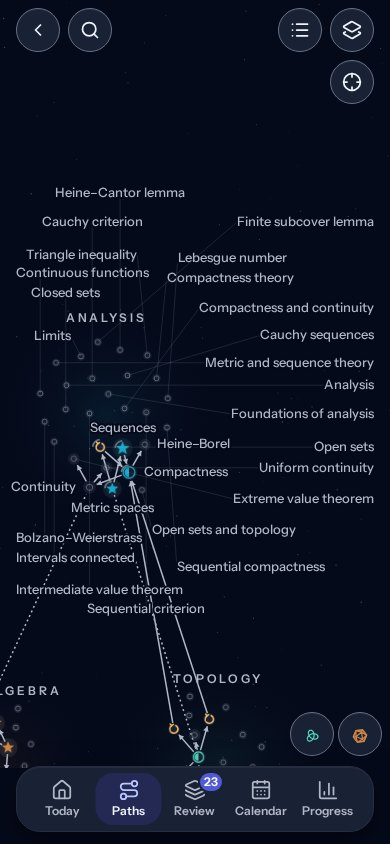

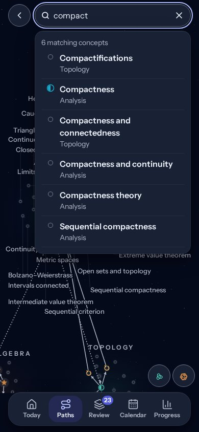

## Before and after

### Today

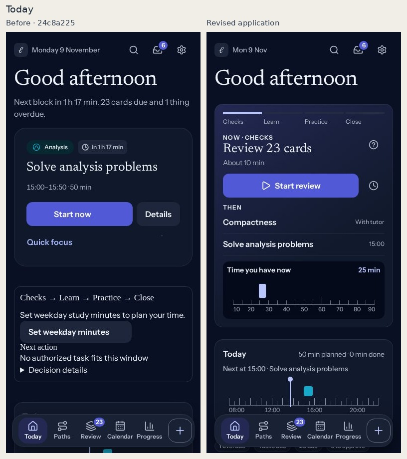

### Atlas List

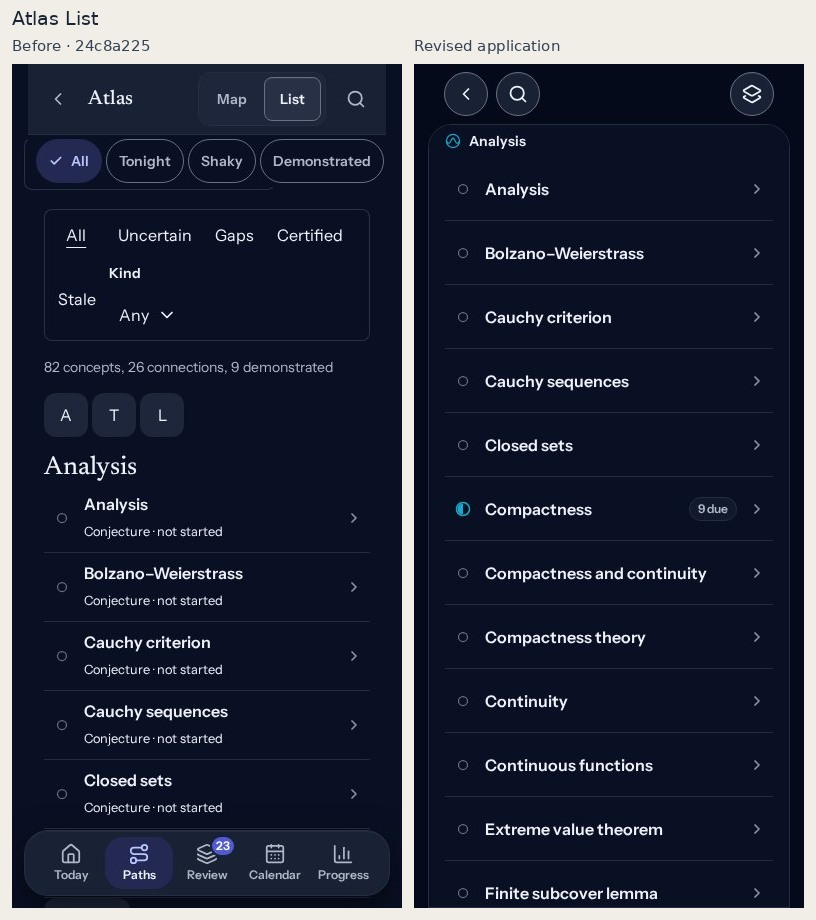

### Tutor with keyboard open

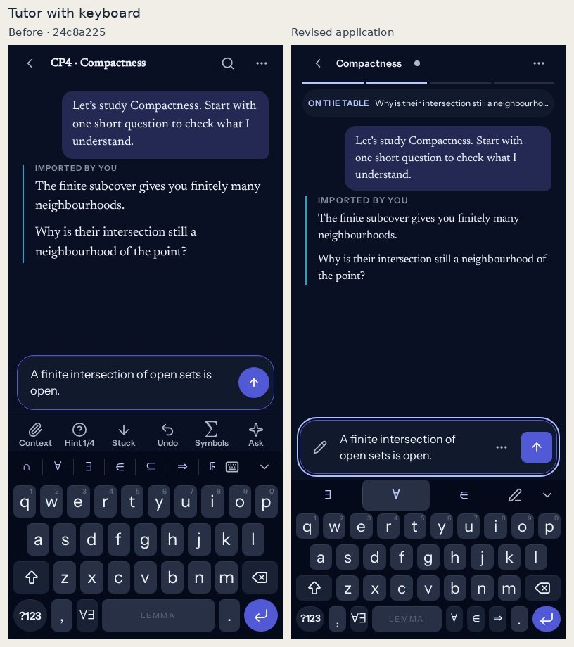

### Path

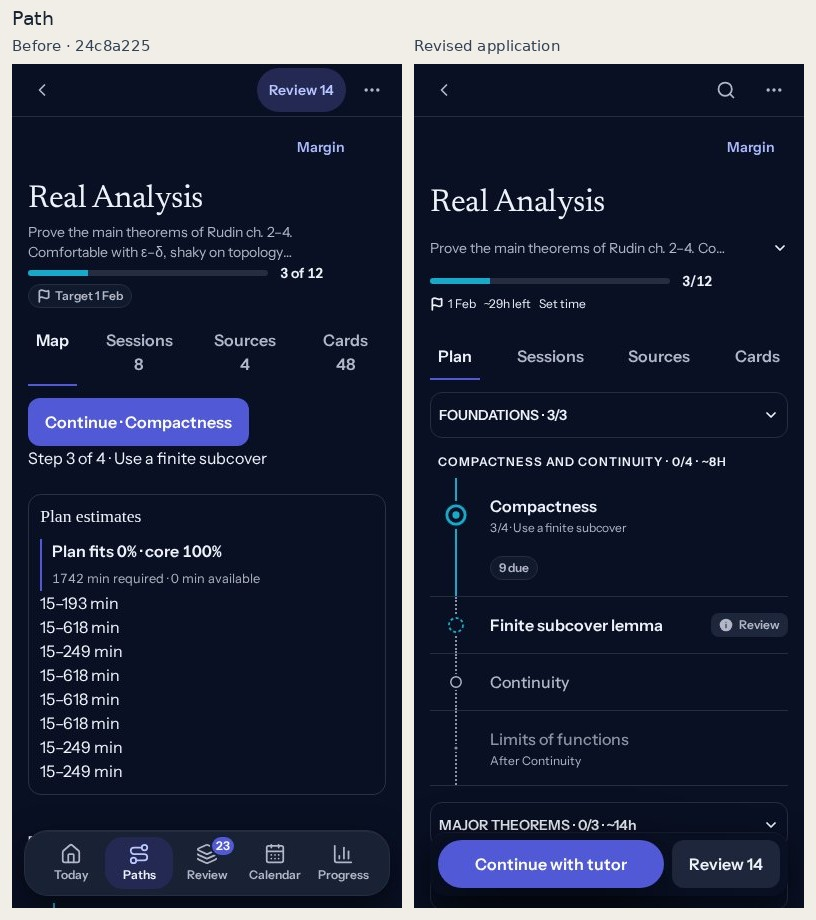

### Calendar

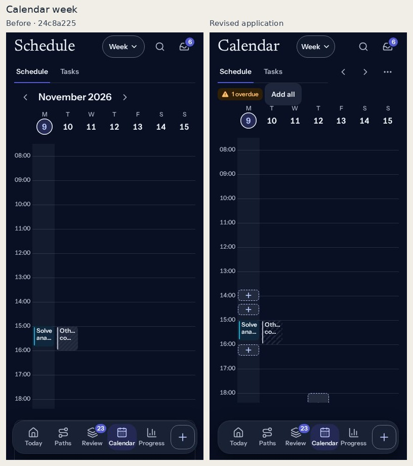

### Review with scratchpad

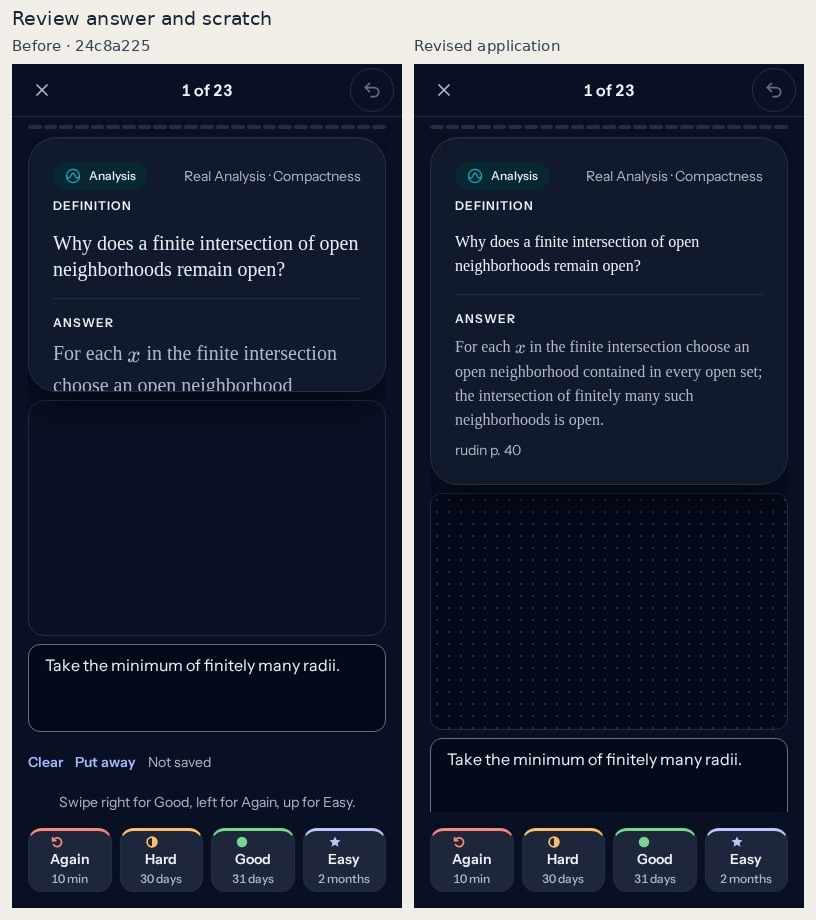

### Progress

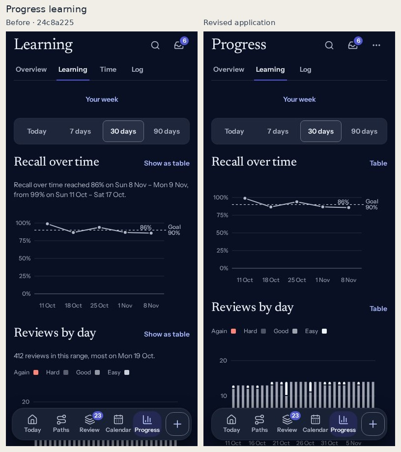

### Tutor settings and math input beta

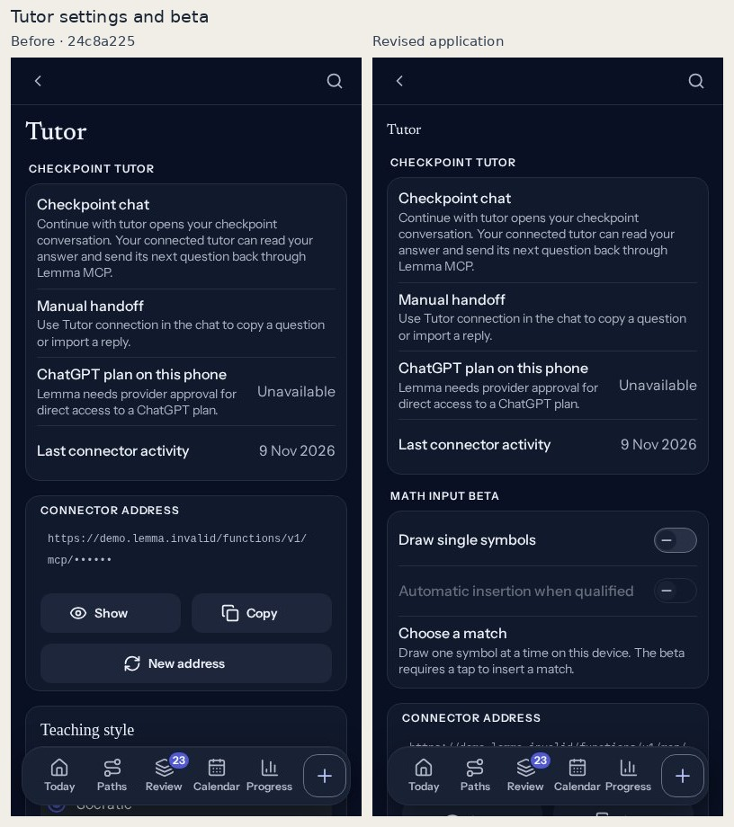

### Create idea

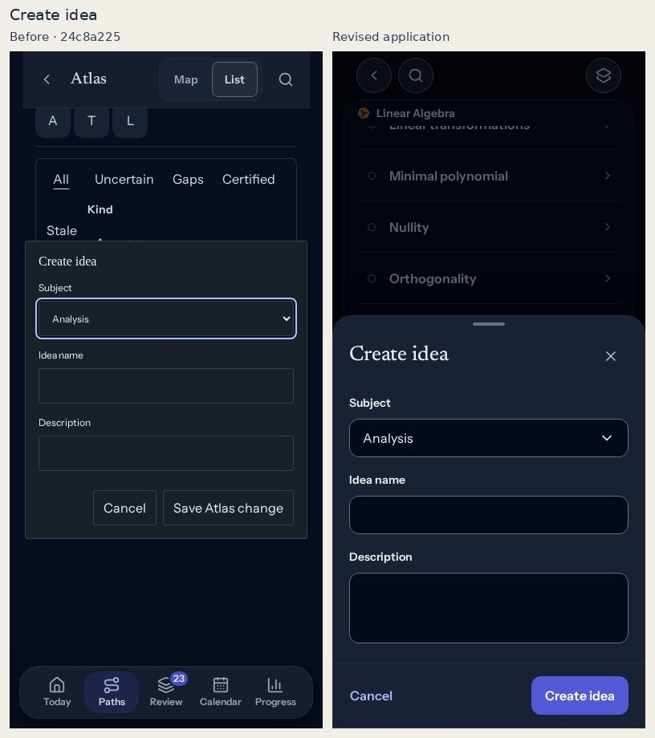

## Drawing inside an answer

The learner can type, insert a drawing at the caret, continue typing, and repeat. Each chip opens its own drawing for editing and can be removed. The saved answer and tutor handoff preserve the text/image sequence. The scratchpad shares the conversation's surface and offers resize, hand pan, and three-finger conversation scrolling.

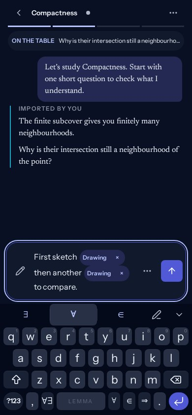

## Single-symbol beta

Enable **Settings → Tutor → Math input beta → Draw single symbols**, then use **Draw symbol** in the custom keyboard. A compact row shows up to three matches and three possible extensions with accessible group labels and a loading spinner. A candidate tap inserts one symbol and returns to typing. **Keep drawing** is optional. **Browse symbols** searches names, TeX commands and shape descriptions with typo tolerance, including when the model is unavailable.

The beta uses a local model and currently requires explicit candidate selection. Automatic insertion is implemented but remains unqualified without representative handwriting calibration and completion evidence. Physical phone performance and native haptics are unmeasured; they are not an owner device-test gate for offering this beta.

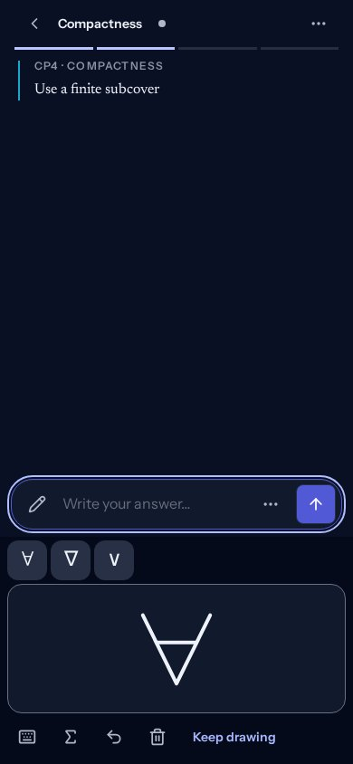

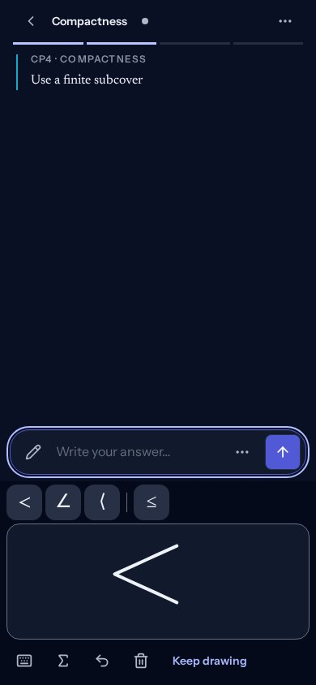

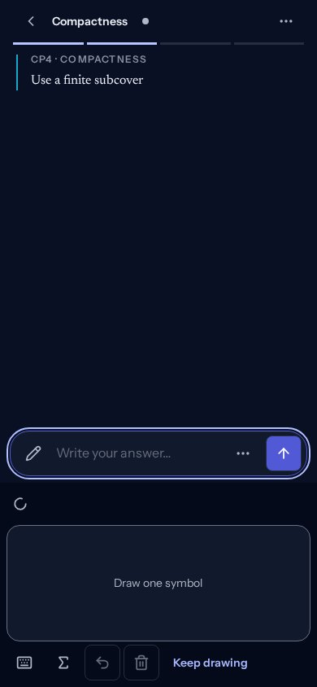

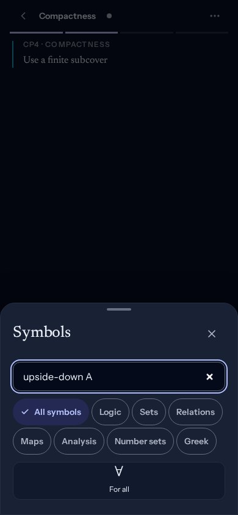

[Recognition simulations and ROC curves](../../../../implementation/2026-11-21/ink-simulation/README.md) record actual local-model results and distinguish synthetic tests from writer accuracy. [Recognizer alternatives](../../handwriting-model-options.md) and [small local text models](../../local-input-model-options.md) cover the Snapdragon 4 Gen 4 / 6 GB target.

## Reproduction and provenance

Use [parity-audit.mjs](../../../../../scripts/v7/parity-audit.mjs) with the [scene catalogue](../../../../../scripts/v7/parity-catalog.mjs), then [package-parity.py](../../../../../scripts/v7/package-parity.py). Capture manifests record the source revision, uncommitted-work indicator, loaded build entries, viewport, theme, route, errors and horizontal overflow. Archive checksums preserve the original JPEG bytes. [Comparison manifest](comparisons/manifest.json) identifies each paired frame.

The loading-only capture pauses the worker's preparation request to hold the real loading UI for inspection. Recognition captures run the actual local model. Screenshots use reduced motion. Atlas search and Calendar Week were recaptured after the final readability fixes; their per-state build entries identify that update, while unaffected frames retain their preceding capture build.

Today recommendation and picture scratchpad captures explicitly enable their existing release flags for review. Those flags remain off by default. The separately controlled single-symbol beta is offered through Settings.
