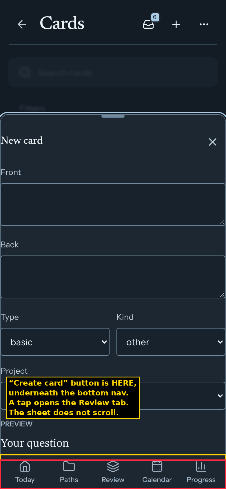
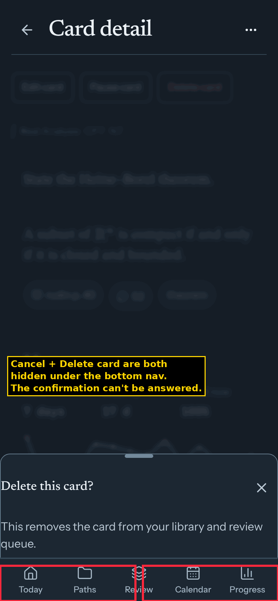
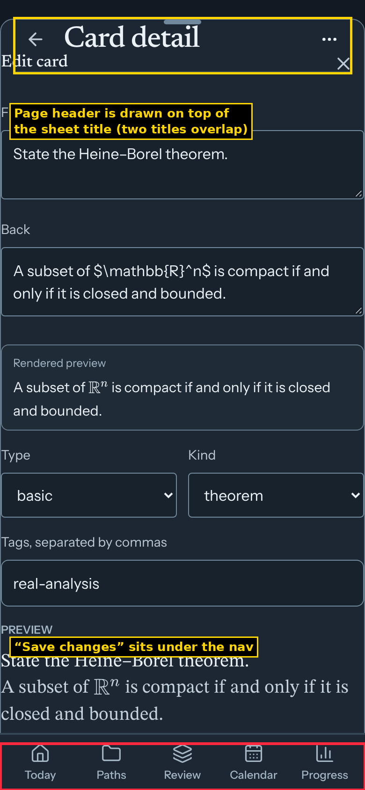
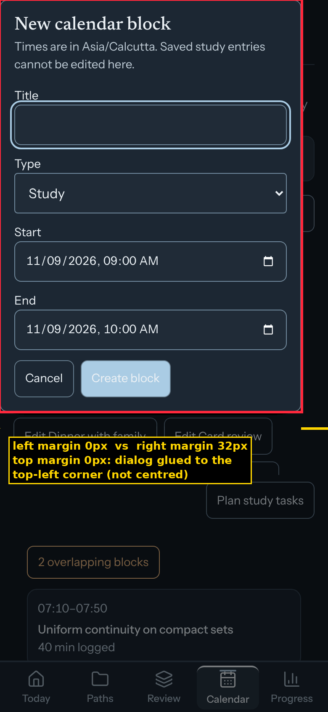
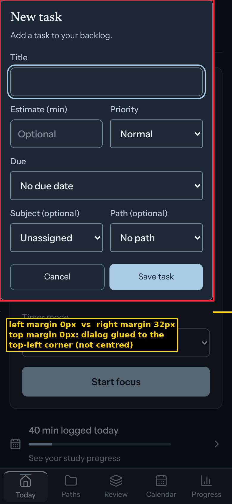
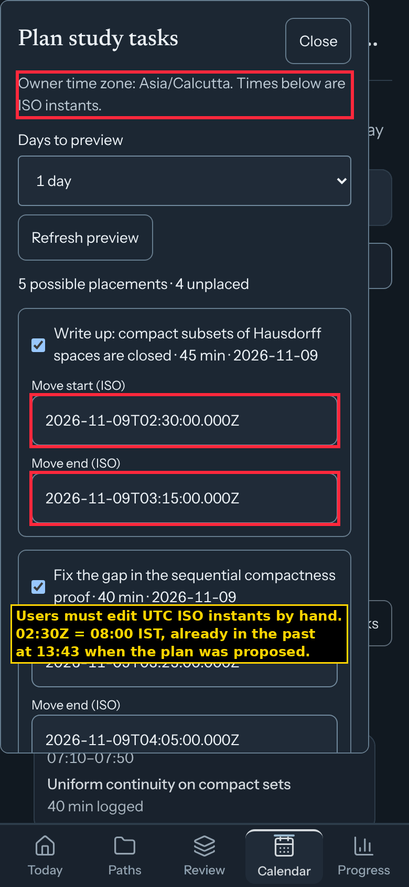
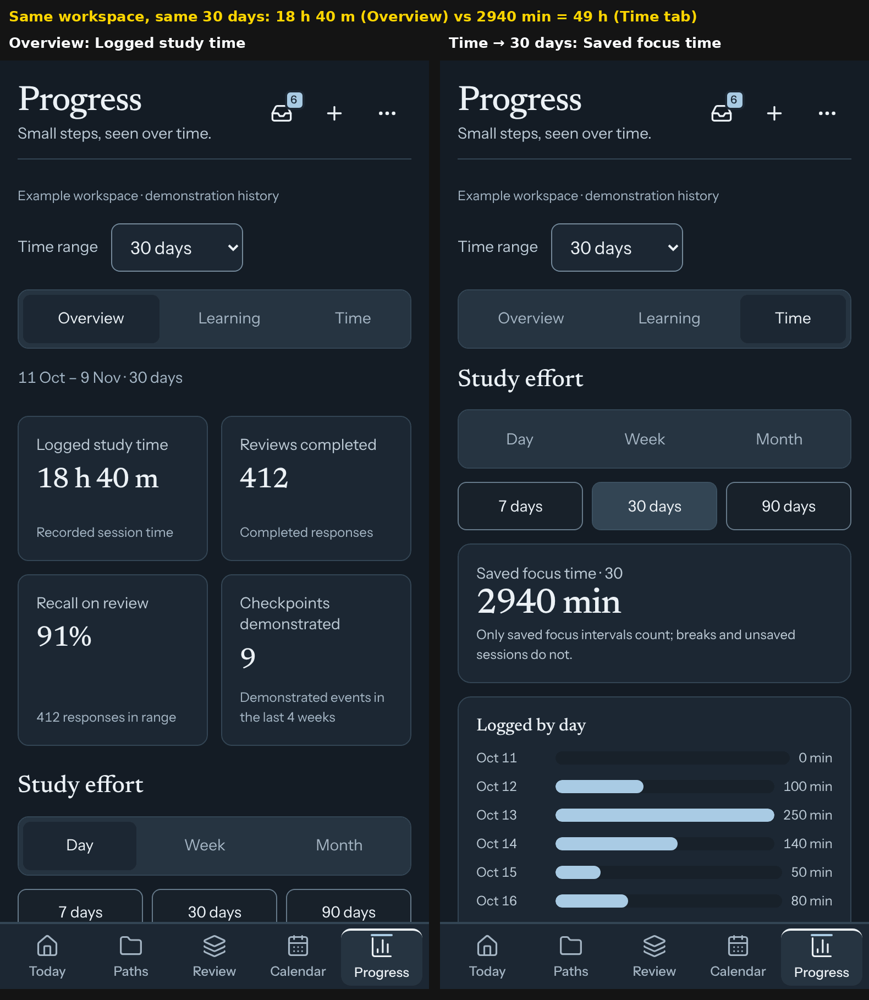
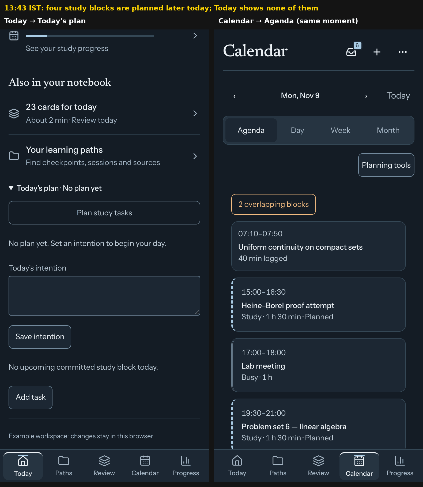
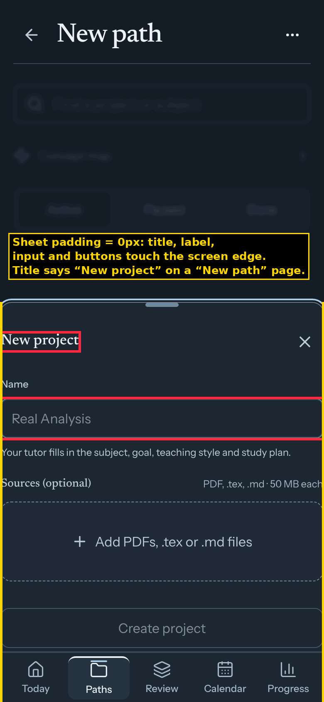

# Lemma v6 UI audit (9 Nov 2026)

**Build tested:** `main` at `f46de0a` (#1340, “Turn v6 on by default”), production build (`npm run build`), demo mode.
**Device profile:** 390 × 844 CSS px phone at 2× (≈ your Android), **Night** first because that is what you use, then Day. Also 320 × 640, 1280 × 800 desktop, and the built-in heavy-data `?demo=stress` profile.
**Locale/time:** `en-IN`, `Asia/Kolkata`, audited at 13:43 IST on Mon 9 Nov.
**Data:** the demo was **seeded with a realistic month of study** before anything was judged (details in [§ Method](#method-and-limits)).

The mockup is not the reference here. Each screen is judged on its own terms: does it look good, does it work, and is the layout correct.

---

## Contents

1. [Verdict](#1-verdict)
2. [Scorecard](#2-scorecard)
3. [Top 15 problems, ranked](#3-top-15-problems-ranked)
4. [Cross-cutting problems](#4-cross-cutting-problems)
5. [Calendar deep dive (your questions answered)](#5-calendar-deep-dive)
6. [Screen by screen](#6-screen-by-screen)
   Today · Focus · Paths · New path · Path · Checkpoint · Session · Review · Review round · Review complete · Inbox · Plan proposal · Cards · Card detail · Concept map · Progress · Settings · Tasks · Time log · Practice · Close the day · Sign-in · Kit
7. [Other widths and heavy data](#7-other-widths-and-heavy-data)
8. [What is genuinely good](#8-what-is-genuinely-good)
9. [Root causes and fix list](#9-root-causes-and-fix-list)
10. [Method and limits](#method-and-limits)

**Severity:** **Blocker** = you cannot finish the task on a phone. **Major** = wrong or misleading information, or a flow most people will abandon. **Minor** = visible defect that makes the app look unfinished. **Polish** = copy or visual nit.

Screenshot paths are relative to this folder. `screenshots/night/NNN-name.png` is the main set; the same `NNN-name` exists in `screenshots/day/`.

---

## 1. Verdict

The five tab screens (Today, Paths, Review, Calendar, Progress) look calm and expensive at first glance: good type pairing, a consistent Night palette, no horizontal scrolling, no console errors. **One tap below that surface the app falls apart.**

- **Core actions are physically unreachable on a phone.** The bottom navigation is deliberately forced to stay visible over every bottom sheet, and those sheets cannot scroll. The **Create card** button in “+ → Card”, **Save** in “Edit card”, both **Cancel** and **Delete** in the delete confirmation, and **Approve** in the Inbox card editor sit under the tab bar. Tapping “Create card” opens the Review tab. This is verified at 390 × 844, 393 × 873 and 412 × 915.
- **Every centred modal is glued to the top-left corner** (your screenshot 1): New task, Edit task, New/Edit calendar block, Filter cards. The left margin is 0 px and the right margin 32 px on a phone; on desktop the right margin is 840 px.
- **Calendar is a list wearing a calendar's name.** There is no time grid, no drag, no resize, no tap-to-create and no tap-to-edit. Day view is a 24-row table with “GMT+5:30” on every row. Week view is a 700 px table you scroll sideways inside a 390 px window, with words split mid-syllable. Month view is a grid of “0m · 0 blocks”. Browsing to a future week marks upcoming deadlines **Overdue**.
- **Internal tools ship as user screens.** The Time log makes you type ISO-8601 instants and edit a JSON array, with raw Subject, Project, Checkpoint and Session ID fields. The planner asks you to edit `2026-11-09T02:30:00.000Z` in UTC, and its slots are already in the past. The plan proposal page shows “Expected a UUID”. Due items print internal record IDs.
- **The numbers contradict each other.** Progress says **18 h 40 m** logged in 30 days, and the Time tab on the same page says **2940 min (49 h)** for the same 30 days. The same focus session reads “On a break” in one card and “Paused” in the dock below it. Today says “No upcoming committed study block today” while four blocks are planned later today.
- **“Today” is not about today.** It shows a three-field form to start a timer and a card count. Today's calendar blocks, the high-priority task due today, four overdue deadlines and two practice topics due today do not appear.

On a phone, the main surfaces would pass a quick look; the flows behind them would not survive a week of daily use.

---

## 2. Scorecard

Scores are out of 5. **Looks** = visual quality, **Works** = does it do the job correctly, **Layout** = alignment, spacing, fit on a phone.

| Screen | Looks | Works | Layout | One line |
|---|:-:|:-:|:-:|---|
| Today | 3 | 2 | 3 | A start-timer form labelled “Today”; ignores your schedule, tasks and deadlines |
| Focus | 4 | 3 | 4 | Best screen in the app; contradictory states and internal jargon behind “Timer details” |
| Paths | 3 | 3 | 3 | Clean but nested and repetitive; the “Archived · New path” row makes no sense |
| New path (sheet) | 1 | 3 | 1 | Zero padding; titled “New project” |
| Path detail | 2 | 3 | 2 | Repeats itself; buttons glued together; sources listed twice |
| Checkpoint | 3 | 3 | 3 | Readable; raw “yes”/“paused” statuses; redundant back button |
| Tutor session | 2 | 3 | 3 | Timestamps with seconds; the same link repeated 4× |
| Review | 3 | 3 | 3 | A lonely search icon, a 4.5-seconds-per-card estimate, “Change” goes to the wrong place |
| Review round | 4 | 4 | 3 | Clean card; grade buttons mid-screen, two exits, nav still visible |
| Review complete | 2 | 2 | 3 | “Q.E.D.” and four dashes when nothing was reviewed |
| Calendar · Agenda | 2 | 1 | 2 | Read-only list; editing hidden in “Planning tools”; overdue logic wrong |
| Calendar · Day | 1 | 1 | 1 | A 24-row spreadsheet with a time zone on every row |
| Calendar · Week | 1 | 1 | 1 | 700 px table in a 390 px window; words split mid-syllable |
| Calendar · Month | 1 | 2 | 2 | Every cell prints “0m 0 blocks” in 11 px text |
| Calendar block dialog | 2 | 2 | 1 | Off-centre, defaults to 09:00 (already past), cannot link to a path |
| Plan study tasks | 1 | 1 | 2 | UTC ISO text fields, slots in the past, raw reason codes |
| Progress | 2 | 1 | 2 | Contradicting totals, raw IDs, three range controls, off-palette green bars |
| Inbox | 3 | 2 | 3 | One-at-a-time pager, raw LaTeX in the queue, toast covers the actions |
| Plan proposal | 2 | 1 | 3 | Shows “Expected a UUID”; offers a JSON payload editor |
| Cards | 3 | 1 | 3 | You cannot create a card on a phone; duplicate prompts with no IDs |
| Card detail | 2 | 1 | 2 | Delete is the third button at the top; edit and delete sheets are unusable |
| Concept map | 2 | 2 | 2 | “Map” is an indented tree; double header; its counts disagree |
| Settings | 3 | 3 | 3 | A 4-group index versus a 10-chip cloud; “Tutor” opens “Connector” |
| Tasks | 1 | 2 | 2 | An admin list: 4 buttons per row, no overdue state, almost no way in |
| Time log | 1 | 1 | 2 | ISO UTC timestamps, a JSON editor, UUID fields; header says “Lemma” |
| Practice | 2 | 2 | 2 | Orphaned; “Due or overdue”; ratings are bare numbers 1–4 |
| Close the day | 1 | 1 | 2 | Orphaned dead end |
| Sign-in | 4 | 4 | 3 | Clean; Google only; no way into the example workspace |

---

## 3. Top 15 problems, ranked

### 1. Blocker: sheet buttons are hidden under the bottom nav, and the sheets don't scroll

  

Measured with a real tap at the centre of each button. The sheets have `overflow: hidden`, so there is no way to scroll the button into view.

| Sheet | 390 × 844 | 375 × 667 |
|---|---|---|
| + → Card (**New card**) | **Create card** under nav; a tap opens the Review tab | same, and Close is under the header |
| **Edit card** | **Save changes** under nav; Close under the header | Save below the screen |
| **Delete card** confirmation | **Cancel and Delete card** both under nav | same |
| Inbox → **Edit** card proposal | **Approve** under nav | same |
| **New path** | “Tell your tutor” under nav | same |

Also verified at 393 × 873 and 412 × 915: the tap still lands on “Review”.
**Cause:** `src/ui/v6/mockup-bindings.css:47-48` forces `nav[data-ui=main-navigation]{display:flex}` whenever a `.ui-sheet` is open (“keep the five destinations reachable, as the release audit requires”). It overrides the rule in `mockup.css:221` that hides the nav behind modals. `mockup.css:309` gives `.ui-sheet` `padding:0; overflow:hidden`. Both came in with #1309.

### 2. Major: every native modal is glued to the top-left corner (phone and desktop)

  

New task, Edit task, New calendar block, Edit calendar block and Filter cards measure **left 0, right 32, top 0** at 390 px. At 1280 px, New task measures left 0 and right **840**. The top edge sits under the phone's status bar, as in your screenshot.
**Cause:** these are `<dialog>` elements opened with `showModal()` and sized with `w-[calc(100%-2rem)]` (`TaskSheet.tsx:105`, `BlockSheet.tsx:156`, `CardFiltersSheet.tsx:63`). Tailwind's preflight resets `margin` to 0 on every element, which removes the browser's `margin:auto` centring. One rule (`dialog:modal{margin:auto}`) fixes all five.

### 3. Major: Calendar has no direct manipulation at all

There are no pointer, drag or touch handlers anywhere in `src/features/calendar/`. You cannot drag, resize, tap an empty slot to create, or tap a block to edit, in any of the four views. Editing happens through “Planning tools” and then a wall of “Edit &lt;title&gt;” buttons, or the Day view's Move button, which opens two datetime fields. See [§5](#5-calendar-deep-dive).

### 4. Major: developer tools shipped as user screens

  

- **Plan study tasks:** “Owner time zone: Asia/Calcutta. Times below are ISO instants.” Fields read “Move start (ISO)” with values like `2026-11-09T02:30:00.000Z`. Unplaced reasons appear as `too_long`, `after_due` and `no_estimate`, and the button says “Commit selected placements”.
- **Time log → Edit entry:** fields “Subject ID: subject-analysis”, “Project ID”, “Checkpoint ID: UUID or blank”, “Session ID”, and “Intervals (ISO instants, JSON array)” holding raw JSON. **Add approximate time** asks for “Start ISO instant” and “End ISO instant”.
- **Plan proposal:** an “Editable proposal draft” box with a “Full draft payload (JSON)” editor. In the demo it shows **“Expected a UUID”** with a “Retry drafts” button.
- **Calendar due item details:** “Read-only projection from an existing linked record · Project: project-analysis · Checkpoint: cp-proof”. In live mode those are UUIDs.

### 5. Major: numbers that contradict each other

- Progress Overview shows **“Logged study time 18 h 40 m”** for 30 days. Progress → Time → 30 days shows **“Saved focus time 2940 min”** for the same 30 days (the seeded total is exactly 2940 min). The headline appears to count tutor sessions, not the focus timer you actually use.
- The same session reads **“On a break · remaining 24:51”** in the Today card and **“Paused 24:50 · Resume”** in the dock directly below it (`088-today-running.png`).
- Concept map header: **“82 concepts · 26 connections”**. The Map view directly below says **“82 ideas · 24 links”**. Under stress data: 1500 vs 1498.
- Review: **“23 cards for today · About 2 min”**. The estimate is hard-coded at 4.5 seconds per card (`ReviewV6.tsx:83`).
- Calendar: overdue is measured against the **first visible day**, not today (`DueDayItems.tsx:28,34`). Open next week and a deadline due on Sunday 15 Nov, still in the future, reads **“Overdue since 2026-11-15”** (`annotated/C03-overdue-relative-to-viewed-day.png`).

### 6. Major: Today ignores today

At 13:43 with five blocks planned later today, a high-priority task due today, four overdue deadlines and two practice topics due, Today shows a timer form, “40 min logged today”, “23 cards for today”, “Your learning paths”, and “Today's plan · No plan yet”. Opening that plan says **“No upcoming committed study block today.”** Today only reads blocks placed through a *committed day plan* (`V6TodayPlan.tsx:18`), so blocks you create in Calendar never appear here. The two planning systems do not talk to each other.

### 7. Major: raw machine formats on 20+ screens

Collected automatically from the visible text of every captured state (`measurements/phone-night.json`):

| Format | Where |
|---|---|
| ISO dates `2026-11-09` | Calendar (all views), Tasks, Practice, Progress goals, Time log, Path “Target date: 2027-02-01”, Close the day |
| UTC instants `2026-11-09T01:40:00.000Z` | Time log (every entry), planner |
| Locale datetimes with seconds `12/11/2026, 10:00:00 am`, `8/11/2026, 3:18:00 pm` | Tasks, Session, Card reviews |
| `00:00 GMT+5:30` on every hour row | Calendar Day |
| The same zone spelled two ways: `Asia/Calcutta` and `Asia/Kolkata` | Calendar and planner vs Progress goals |
| Raw IDs `subject-analysis`, `project-analysis`, `cp-proof` | Progress “By subject”, due details, Time log |
| Raw codes `too_long`, `after_due`, `no_estimate`; `yes`; `Rating: 3` | Planner, Checkpoint sessions, Time log |
| Raw LaTeX `$U_y$` and cloze `{{c1::compact}}` | Inbox → Browse queue (`annotated/A08-inbox-raw-latex-cloze.png`) |
| 12 h and 24 h mixed | Calendar cards `19:30–21:00`, conflicts `8:00 PM–8:45 PM`, Focus `2:30 pm` |
| Eight duration styles | `18 h 40 m`, `1 h 30 min`, `2940 min`, `200m`, `17 d`, `7 days`, `1.6mo`, and decimal minutes `0.1` |

### 8. Major: sheets with zero padding, and sheets drawn under the header

 

New path, New card, Edit card and Delete card are all `padding: 0px`, with content 1 px from the screen edge. At 390 px the Edit card sheet starts under the page header, so “Card detail” is drawn over “Edit card”. At 320 px the New card sheet does the same.

### 9. Major: features you cannot reach

- **Practice** (`/practice`) and **Close the day** (`/today/close`) are not linked from anywhere in the app.
- **Tasks** is reachable only through the transient “Task saved · View in backlog” message that appears after creating a task.
- **Time log** is reachable only from two links deep inside Progress.
- The ⋯ menu offers just Concept map, Card library and Settings.
- “+ → Time block” does not create a block; it only opens `/calendar` (`V6Header.tsx:40`).

### 10. Major: a pile of overdue items buries the agenda and repeats on every page

Overdue deadlines and practice topics are re-attached to the first day of whatever range you view: the bottom of today's agenda, the top of next week, and the Monday column in Week view. They can't be completed, snoozed or opened from there (`035`, `036`, `043`). Your screenshot 2 shows the same pile.

### 11. Minor: mixed control language

Native unstyled `<select>`s sit next to custom segmented controls. Default `
` triangles (▶) sit next to custom chevrons. There are three segmented-control styles (filled pill, underline in Appearance, plain buttons for 7/30/90 days). Goal bars are pure green, a colour used nowhere else. Good and Easy share almost the same green in “Reviews by day”. The “16” label is clipped at the right edge of that chart.

### 12. Minor: redundant navigation and duplicated content

- Several screens have a second back control: header back arrow plus “Back to Today”, “Back to path”, “Back to path sessions”, “✕ Leave”, “‹ All settings”, and “Switch path”, which simply goes back to the Paths list.
- Several screens have duplicate headings: Tasks “Tasks” + “Tasks”, Practice, and Time log (“Lemma” + “Today” + “Time log”).
- Content is duplicated: Progress Overview and the Time tab repeat the same Study effort block; Path detail lists every source twice; Inbox “Browse queue” shows two lists of the same proposals; Card edit has two previews; Today has two different “intention” fields (focus intention and day intention).

### 13. Minor: three routes are titled “Lemma”

Time log, Practice and Close the day are missing from the title map (`V6Header.tsx:11`).

### 14. Minor: desktop is a stretched phone

The content is a 640–720 px column with a 1280 px-wide five-tab bar across the bottom. Week view stays inside that column (about 95 px per day), still splitting words, while more than 500 px of the screen sit empty (`screenshots/desktop-1280/`).

### 15. Minor: the example workspace makes a bad first impression

- `src/data/study/demo.ts:64-65` seeds saved sessions on Wednesday and Friday of the current week, so most days they are in the future. Progress then opens with “Some saved time entries overlap or need correction”, and the Time log lists sessions dated next Friday (`screenshots/default-demo-night/`).
- The card library repeats the same two prompts per checkpoint.
- The first Inbox card's answer does not answer its question (“Why must U_y and V_y be disjoint?” → “So the intersection of finitely many V_y is an open set…”).
- The plan proposal page shows the “Expected a UUID” error.

---

## 4. Cross-cutting problems

| # | Problem | Severity | Evidence |
|---|---|---|---|
| X1 | Bottom nav covers sheet actions; sheets don't scroll | Blocker | §3.1, `measurements/`, `annotated/A03–A05` |
| X2 | Native modals pinned top-left (phone and desktop) | Major | §3.2, `annotated/A01–A02`, `screenshots/desktop-1280/004-task-sheet-new.png` |
| X3 | Bottom sheets with 0 px padding; sheets drawn under the header | Major | `annotated/A05–A06` |
| X4 | Raw dates, UTC instants, IDs, enum codes, LaTeX | Major | §3.7 |
| X5 | Orphaned routes (Practice, Close the day); hidden routes (Tasks, Time log) | Major | §3.9 |
| X6 | Two disconnected planning systems (calendar blocks vs day plans) | Major | §3.6 |
| X7 | Contradictory metrics | Major | §3.5 |
| X8 | No overdue styling anywhere (Tasks, Calendar, Practice); “overdue” computed wrongly in Calendar | Major | `072-tasks*.png`, `036`, `043` |
| X9 | The “Approved” toast has no Undo button, although the batch copy talks about an “Undo window”; the toast also covers the action bar | Minor | `054-inbox-approve.png`, `Selection.tsx:72`, `proposals/Page.tsx:350` |
| X10 | Manual “Refresh” buttons (Tasks, Practice, planner “Refresh preview”, “Retry drafts”) | Minor | `072`, `078`, `034` |
| X11 | Buttons with no gap between them (“Switch path · Concept map”, “Show archived topics · Refresh topics”) | Minor | `014-path.png`, `078-practice.png` |
| X12 | Destructive actions styled like neutral ones (“Delete block” next to “Save changes”), or promoted to the top of the page (card detail “Delete card”) | Minor | `033`, `060` |
| X13 | Field errors are not attached to fields (“Enter a task title.” below the whole form, Title not marked invalid) | Minor | `005-task-sheet-error.png` |
| X14 | Accessibility: KaTeX math is dropped from link names (“What is the indiscrete topology on ?”). Practice buttons read “Practice” but are named “Manage ε–δ proofs”, so voice control fails. The Time log “Today” link is 18 px tall. Month view uses 11 px text. | Minor | aria snapshot, `042`, `074` |
| X15 | Copy written for engineers: “Plan block in sheet”, “Commit selected placements”, “Selected eligible”, “Disposition: Keep both”, “Attribute to …”, “Server phase deadline”, “Retake control”, “requires timer control”, “No verified transcription pages”, “1 page need checking”, “1 saved entries”, “Showing 1 of 1 pages (50 per page)”, “Browse 82 concepts and 0 groups” | Minor | throughout |

---

## 5. Calendar deep dive

You asked how to drag and what it shows. Here is everything the Calendar actually does.

### 5.1 How do I drag?
You can't. There is no drag, resize, long-press or tap-to-create in any view. The code has no pointer or touch handlers (`src/features/calendar/**`). Blocks in Agenda, Week and Month are inert text; tapping one does nothing. The only tap targets are the day headers in Week and the day cells in Month, which switch to Day view.

| You want to… | What the app makes you do |
|---|---|
| Create a block | Tap **Planning tools** → **Plan block in sheet** → fill a dialog glued to the top-left corner. Start defaults to **09:00–10:00 today**, already in the past at 13:43. In Day view there is also an always-open “Add a block” form above the schedule. “+ → Time block” only opens Calendar. |
| Edit a block | **Planning tools**, then find “Edit &lt;title&gt;” in a clipped, scrolling wall of buttons for the whole week (`031-calendar-tools.png`). Or switch to **Day** view and use **Move**, which shows two datetime fields. |
| Move it to another time | Type new date and time values (Day view → Move, or the edit dialog). |
| Link a block to a path or task | Not possible from any block UI, although the data model supports it. |
| Act on an overdue deadline | Not possible. Tapping one expands read-only details with internal IDs. |

### 5.2 What does each view show?

   

**Agenda** (`030-calendar-agenda*.png`)
- A 7-day list of cards. Today's date heading is visually hidden, so the list starts with no date and there is no sticky day header while scrolling.
- Cards are inset 16 px from every other element's edges, so the grid is misaligned.
- Logged sessions, planned blocks, busy blocks, deadlines and practice items are distinguished only by a dashed versus double 3 px left border and bold versus regular titles. There is no colour per subject and no legend.
- “2 overlapping blocks” is an amber chip that doesn't say which blocks. It isn't tappable, and it appears only for the first day, so Wednesday's overlap gets no chip.
- **Major:** overdue items from 31 Oct are appended to today and to every first visible day after it.
- **Major:** “Overdue” is relative to the viewed day, so future deadlines show as overdue when you look ahead (`annotated/C03-overdue-relative-to-viewed-day.png`).

**Day** (`037-calendar-day*.png`, `039-calendar-day-dense*.png`)
- Opens with “Time accounted for: Logged 40 min · Busy 105 min · Planned 165 min · **Free 1130 min**”. Free time counts the whole 24 h day, including sleep, and is given in minutes.
- An always-open **Add a block** form pushes the schedule below the fold.
- The schedule is a 24-row table “Hour | Logged study | Planned blocks”, each row labelled “HH:00 **GMT+5:30**”, about 7 screens of scrolling for one day.
- Blocks appear only in their **starting** hour: a 15:00–16:30 block occupies the 15:00 row and leaves 16:00 empty. There is no “now” line.
- Each content column is about 100 px wide, so titles break mid-word (“Seminar: represent / ation theory”). Every block carries stacked Move, Done and Delete buttons.
- Overlapping blocks stack vertically with nothing marking the overlap.

**Week** (`040-calendar-week*.png`, `041-calendar-week-scrolled.png`)
- Seven bordered columns in a **700 px** horizontal scroller, so a phone shows about 3½ days with no hint that it scrolls. There is no time axis.
- Text breaks mid-word everywhere: “Subgroup s, cosets”, “Conferenc e (all day)”, “assignme nt 3”, “representa tion theory”. Headers wrap to “Mon, Nov / 9” and “Logged 40 / min”.
- Overlap cards (“Keep both / Attribute to Seminar: representation theory”) **overflow into the neighbouring column**, and use 12-hour times inside an otherwise 24-hour view.
- At 1280 px the week is still squeezed into a 720 px column, about 95 px per day.

**Month** (`042-calendar-month*.png`)
- Every cell prints “Nm”, “N blocks” and optionally “N due” and “N conflicts” in 11 px text. Most cells read “0m · 0 blocks”: no dots, no shading, no colour.
- Rows change height depending on their text.
- Below the grid, “Time conflicts” lists every overlap with “Keep both / Attribute to …” buttons. Logging study inside a block you planned is counted as a conflict (“Overlap acknowledged · 7:00 AM–7:20 AM … Disposition: Keep both”), so doing what you planned gets flagged.

**Navigation**
- The header always shows a single day (“‹ Mon, Nov 9 ›”), even in Week and Month view, where “November 2026” appears again below it.
- In Agenda the arrows jump 7 days.
- The arrows are 24 px text glyphs.

**Planning tools** (`031-calendar-tools*.png`): opening it stretches the summary to full width, left-aligns “Plan block in sheet”, adds one button per block in the range inside a 224 px clipped scroll box, and right-aligns “Plan study tasks”. Your screenshot 2 shows the version with no blocks.

**Plan study tasks** (`034-calendar-planner*.png`, `annotated/A07-planner-iso-utc-fields.png`)
- Proposes placements for today at 08:00, 08:55, 09:45 and 11:25 IST when it is already 13:43, so every slot is in the past.
- You adjust a slot by editing a UTC ISO string.
- Unplaced reasons are shown as raw codes.

**Block dialog** (`032`, `033`)
- Off-centre, with the subtitle “Times are in Asia/Calcutta. Saved study entries cannot be edited here.”
- Title has no placeholder.
- “Delete block” uses the same style as “Save changes”.
- There is no path, task or checkpoint field.

### 5.3 What a usable calendar needs (minimum)
A day and week time grid where block height equals duration, a now-line, tap an empty slot to create (prefilled with that time), tap a block to open it, drag to move and drag the edge to resize (with Move as the accessible fallback). Add subject colours, overlap shown side by side, overdue items in one dismissible “Overdue” banner computed against today, and a Month view with dots or heat instead of numbers.

---

## 6. Screen by screen

Each finding cites the screenshot(s) that show it.

### Today (`001-today*.png`, `002`, `003`, `006`, `082`, `088`)
1. **Major:** Not about today. Today's blocks, tasks due, overdue deadlines and practice due are all missing (`annotated/C02-today-ignores-calendar.png`).
2. **Major:** The idle state is a three-field form (intention, activity, timer mode) filling the whole first screen. A daily-use home screen should start with what's next, not a settings form.
3. **Major:** “Today's plan” says “No upcoming committed study block today” while four blocks are planned later today (`006-today-plan-open.png`).
4. **Minor:** Two different “intention” fields on one screen: “Focus intention” at the top and “Today's intention” inside Today's plan.
5. **Minor:** “Activity” already includes the timer mode (“Proof workshop · pomodoro · 25 min”), yet a second select, “Timer mode”, repeats it, plus a caption repeating it a third time (`082-focus-form.png`).
6. **Minor:** “23 cards for today · About 2 min” (4.5 s per card, hard-coded).
7. **Minor:** The “40 min logged today” bar has no goal or label, so its length means nothing.
8. **Minor:** Inconsistent label weights: “Activity” is bold, “Focus intention” and “Timer mode” are regular.
9. **Polish:** The decorative “∂” glyph collides with the heading. The τ watermark on a Real Analysis focus card belongs to Topology (`088`).
10. **Polish:** “Today's plan” uses the browser's default ▶ triangle.

### Focus (`083`–`087`, `091`, dock in `088`–`090`)
1. **Major:** Contradictory state. The Today card says “On a break”; the dock says “Paused” (`088-today-running.png`).
2. **Minor:** During a break the timer shows the frozen focus countdown (24:53) with “25 min focus / 5 min break” underneath. Nothing shows how long the break has left (`087`).
3. **Minor:** Two equally strong filled buttons, **Pause** and **Finish & log**. Pause and Resume carry an odd offset shadow no other button has.
4. **Minor:** “Timer details” is plain text with no disclosure affordance. Inside: “Server phase deadline: 2:30 pm”, “Retake control”, “Next phase” (`084`).
5. **Minor:** Finish shows “Minutes to save: **0.1**”, a decimal minute in a text field (`091`).
6. **Polish:** Park a thought and Noticed a distraction mix centred titles and labels with left-aligned buttons. “Exclude these minutes from logged focus (requires timer control)” (`085`, `086`).
7. What works: the main timer screen is the cleanest layout in the app.

### Paths (`007`–`011`)
1. **Minor:** Every subject is a collapsible card even with one project inside (“∫ Analysis · 1 project” → “Real Analysis”), which halves density.
2. **Minor:** Naming: the tab is Paths, the search says “Find a project or subject”, and counts say “1 project”.
3. **Minor:** “3 of 12” has no noun; “Now CP4 Compactness” uses internal codes.
4. **Minor:** The bottom row puts “Archived” on the left and “New path ›” on the right, two unrelated actions on one row (`009`, `010`).
5. **Minor:** ⋯ expands inline into “Pin · Archive · Close”. “Close” means close the menu but reads like closing the path, and it sits orphaned on a second row (`008`).
6. **Polish:** The “Concept map” link row sits between the search and the status filter.

### New path (`012`, `013`, `annotated/A06-new-project-sheet-no-padding.png`)
1. **Major:** 0 px padding; the content touches the screen edges.
2. **Major:** The bottom action is under the nav (§3.1).
3. **Minor:** The page says “New path”, the sheet “New project”, the button “Create project”.
4. **Minor:** The placeholder “Real Analysis” looks like a filled value.
5. **Polish:** “Name” is a sans label while “Sources (optional)” is serif. The grip handle suggests dragging that doesn't exist.

### Path detail (`014`–`017`)
1. **Minor:** “Switch path” and “Concept map” buttons touch (0 px gap). “Switch path” just returns to the list.
2. **Minor:** “Next step: Step 3 of 4”, then “Step 3 of 4 · Analysis” again. The actual next step (“Use a finite subcover”) appears only on the checkpoint page.
3. **Minor:** “Target date: 2027-02-01 · Forecast unavailable”.
4. **Minor:** The stage chips scroll sideways with no affordance; the third chip is cut to “M”. In Night the selected chip is solid white and glares.
5. **Minor:** “Tutor sessions 8 / Sources 4” tiles sit next to “Show sessions (8) / Show sources (4)” buttons. Sources are listed twice (names as buttons, then detail cards). Each card repeats “1 of 342 pages transcribed” and says “1 page need checking” (`017-*-2.png`).
6. **Polish:** “rudin p. 40”, a lowercase source key.

### Checkpoint (`018*.png`)
1. **Minor:** Redundant “Back to path” button, floated right on its own row.
2. **Minor:** Prerequisite shows only “CP3 · Demonstrated”, without the title.
3. **Minor:** The tutor sessions list shows raw values “yes” and “paused”. Evidence rows use raw labels “explanation · partial”, “hint · Hint 2”.
4. **Minor:** A paragraph explains what Study, Demonstrate and Defer *don't* do, a sign the buttons are unclear.

### Tutor session (`019*.png`)
1. **Minor:** “8/11/2026, 3:18:00 pm”, with seconds, on the session and every timeline row.
2. **Minor:** “Checkpoint CP4” is repeated as a link under every timeline item (4×).
3. **Minor:** An empty “Pick up where you left off: No resume question recorded.” section with a full heading.
4. **Minor:** Redundant “Back to path sessions”. “Goal met” is styled exactly like the “Checkpoint CP4” button but isn't one.

### Review (`020`–`024`)
1. **Major:** “Today's batch · Change” opens the **Settings index**, not the daily-limit setting (`024`).
2. **Minor:** The first row is a lone 🔍 icon on a full-width ruled row. It opens Decks & options far down the page, so the field appears 500 px from where you tapped (`022`).
3. **Minor:** “Decks & options ›” has a forward chevron but expands in place.
4. **Minor:** “About 2 min” for 23 proof cards. The “A SMALL SESSION, LASTING IDEAS” eyebrow is decoration.
5. **Minor:** “Queue details” shows “All due: 23 · Selected eligible: 23 · This round: 23”; the disclosure uses the browser's default ▶.
6. **Polish:** Deck rows use “Less” as the collapse label.

### Review round (`025`–`027`, `029`)
1. **Minor:** Two exits: the header back arrow and “✕ Leave”. The bottom nav stays visible during a focused review.
2. **Minor:** The grade buttons sit mid-screen, not in the thumb zone. “Again 10m” is a full-width red bar; the others are “✓Hard 30d / ✓Good 1mo / ✓Easy 1.6mo”. The checkmarks are noise and month abbreviations are unusual.
3. **Minor:** “DEFINITION” and “Note 1 · definition” say the same thing twice.
4. **Polish:** The direct link `/review/run` dead-ends at “No saved review run was found.”

### Review complete (`028`)
1. **Minor:** Opened directly, it celebrates “**Q.E.D.**” over four tiles of “–” and “Review a round to see stats.”

### Inbox (`049`–`054`, `096`, `annotated/A08-inbox-raw-latex-cloze.png`)
1. **Blocker:** Edit → **Approve** is under the nav (§3.1).
2. **Major:** “Browse queue” shows raw LaTeX and cloze syntax (`$K$ is {{c1::compact}}…`), then a second list of the same proposals rendered properly (`051*`).
3. **Major:** Triage is one card at a time (“1 of 149” under stress). The pager uses two giant 150 px buttons, the disabled one grey and the enabled one white, so it reads like a toggle.
4. **Minor:** After Approve, an “Approved ✕” toast covers the action bar, and there is no Undo (`054`).
5. **Minor:** “why” as a lowercase label next to a “Why this card?” button; “∫ CP4·S7” codes. The opened explanation sits behind the action bar (`050`).
6. **Minor:** The header shows the Inbox icon (with badge) while you're on the Inbox.
7. **Polish:** The Plans tab card is the best-designed proposal view in the app; use it as the pattern.

### Plan proposal (`055*.png`)
1. **Major:** “Editable proposal draft · Retry drafts · **Expected a UUID**” in the demo. In live mode it offers a raw “Full draft payload (JSON)” editor.
2. **Minor:** The meta row shows the slug “real-analysis” instead of “Real Analysis”.
3. **Minor:** The change is buried: two full 12/13-tile grids, with “Added” and “Changed” as small tinted words. Show the diff first.

### Cards (`056`–`059`)
1. **Blocker:** + → Card (New card) cannot be saved on a phone (§3.1).
2. **Major:** List rows carry no card number or deck, so duplicate fronts are indistinguishable. The demo repeats two prompts six times each.
3. **Minor:** Order is unexplained (“in 7d” rows come before “Due” rows).
4. **Minor:** Filter dialog is off-centre (§3.2). “Checkpoint code” is free text, so you have to know “CP4”.
5. **Minor:** New card sheet: 0 px padding, “Type: basic”, “Kind: other”; the page behind scrolls instead of the sheet (`059*`).

### Card detail (`060`–`062`)
1. **Blocker:** Edit card → Save is under the nav; the delete confirmation's Cancel and Delete are both under the nav (§3.1).
2. **Major:** The edit sheet starts under the header, so two titles overlap (`annotated/A05-edit-card-sheet-under-header.png`).
3. **Minor:** The first thing on the page is “Edit card · Pause card · **Delete card**”, a destructive action at the top in red. Lower down, “Suspend card” sits next to the earlier “Pause card”: two names for one idea?
4. **Minor:** The Memory sparkline has no axes or labels. “Next 7 days” and “Stability 17 d” use two unit styles in one row, in monospace.
5. **Polish:** “Addressed by claude” (lowercase). Two previews in the editor.

### Concept map (`063`–`066`, stress `065`)
1. **Major:** “Map” is an indented tree with link arrows crammed in the right gutter. Under stress data the gutter is a tangle of lines with “(2)”, “(4)” and “+24” badges.
2. **Minor:** A double header: “← Concept map” and then “← Atlas” with its own back arrow and search. The numbers disagree (26 connections vs 24 links). Names drift between concept, idea and Atlas.
3. **Minor:** The list is a bare name per 65 px row, with no status, progress or due count until you tap. “Browse 82 concepts and 0 groups” shows 82 three times on one screen.
4. **Minor:** Row actions (“View on map · Pin on map · Edit idea · Preview edits · Checkpoint CP4”) have text touching the button borders (`064`).
5. **Minor:** The tab strip “Fields · Areas · Topic|” is clipped; “Re-check 1” wraps onto two lines.

### Progress (`044`–`048`, `093`–`095`, your screenshot 3)
1. **Major:** Contradictory totals (§3.5).
2. **Major:** “By subject: **subject-analysis** 40 min”, a raw ID instead of “Analysis”.
3. **Major:** **Three** range controls on one page: the “Time range 30 days” select, Day/Week/Month, and 7/30/90 days. The select doesn't affect the effort section, and the last two are one control split in two (selecting “30 days” deselects Day/Week/Month).
4. **Minor:** “Logged by day” is 30 rows of horizontal bars, 1½ screens long. With no data it is 30 rows of “0 min” (your screenshot 3). It should be a compact chart with an empty state. Week mode shows future days as “0 min”.
5. **Minor:** Goal cards show ISO date ranges, “Asia/Kolkata” on every card, “Linear Algebra · Linear Algebra”, pure-green bars on grey, and two buttons per goal.
6. **Minor:** Last week's goal (2–8 Nov) is still listed as active, with “200 min remaining” after it ended.
7. **Minor:** “Saved focus time · 30 — 2940 min” (missing “days”; 49 h shown as minutes).
8. **Minor:** Learning tab: the Good and Easy colours are nearly identical, the “16” axis label is clipped, the Checkpoints bars have no values, and the stat tiles switch to monospace.
9. **Minor:** Metric cards are equal height with top-aligned content, so values don't line up across a row (“91%” vs “9”).
10. **Polish:** “Checkpoints demonstrated … in the last 4 weeks” sits beside a 30-day range.

### Settings (`067`–`071`)
1. **Minor:** The index has 4 groups. Inside, a cloud of 10 chips with different names appears (Account, Appearance, Study defaults, Activities, Focus, Planning, Reminders, Subjects, Connector, Export). Tapping **Tutor** opens a section titled **Connector**. Two or three chips look selected at once (`069`, `070`).
2. **Minor:** Settings reopens the last section instead of the index; you need “‹ All settings” plus the header back arrow to get out.
3. **Minor:** Teaching style is seven full-width buttons, with the selection shown as the text “Socratic · Selected”.
4. **Polish:** The Appearance segmented control uses an underline; every other one is a filled pill. The Connector shows only “ChatGPT setup”, while the last app was Claude.

### Tasks (`072`, `073`; orphaned route)
1. **Major:** No way in except the post-save message.
2. **Major:** No overdue state: tasks due 7 and 8 Nov look identical to future ones.
3. **Minor:** Four buttons per row (Complete · Edit · Up · Down). Completed and Cancelled tasks still get Up and Down. A cancelled task offers “Complete” but not “Reopen”.
4. **Minor:** Two date formats in one list: “Due 2026-11-09” and “Due 12/11/2026, 10:00:00 am”.
5. **Minor:** A double “Tasks” heading; “13 shown of 13 tasks”, “Backlog (6 shown)”; a manual “Refresh”.
6. **Minor:** Edit dialog is off-centre; the long title shows as a one-line input scrolled to its end (“t subsets of Hausdorff spaces are closed”).

### Time log (`074`–`077`)
1. **Major:** Every entry prints UTC ISO intervals (`focus: 2026-11-06T16:30:00.000Z – …`), so a 22:00 IST session reads 16:30.
2. **Major:** Add and edit are database forms: ISO instant fields, Subject, Project, Checkpoint and Session IDs, and a JSON intervals editor (§3.4).
3. **Minor:** The header says “Lemma”; a “Today” link sits above an h1 “Time log”.
4. **Minor:** A native date picker for “Week starting”; four full-size buttons stacked; “1 saved entries · Showing 1 of 1 pages (50 per page)”; “Rating: Unknown”; ISO day headings.

### Practice (`078`, `079`; orphaned route)
1. **Major:** Not linked from anywhere.
2. **Minor:** The header says “Lemma”. “Due or overdue” is used for both yesterday and today; other topics show “Due on 2026-11-12”.
3. **Minor:** Card layouts differ (the button sits beside the title on one card and below it on the next). “Rating (1–4)” is a bare number select with no meaning attached.
4. **Minor:** “Show archived topics (1)” and “Refresh topics” touch. A standalone “Card review is separate” link repeats the description.

### Close the day (`080`; orphaned route)
1. **Major:** Not linked from anywhere, and it dead-ends: “No day plan exists for this date. Create one from Today before closing it.” The only way to create one is Today → Today's plan → Plan study tasks → “Commit selected placements”, the UTC ISO-instant planner from §5.
2. **Minor:** The header says “Lemma”. The “Close the day” heading is right-aligned beside a “Back to Today” button. The date and zone show as “2026-11-09 · Asia/Calcutta”.

### Sign-in (`092-sign-in-live.png`)
1. **Minor:** Google is the only option, and there is no link into the example workspace for someone evaluating the app.
2. **Polish:** All content sits in the top half; nice type.
3. In demo mode, `/sign-in` dead-ends at “Sign-in is available in live mode.” with no button (`default-demo-night/sign-in.png`).

### Kit (`081-kit.png`)
1. **Minor:** A developer component gallery (“Amber on Obsidian · The study interface”, an old theme name) ships in production at `/kit`.

---

## 7. Other widths and heavy data

**320 × 640** (`screenshots/phone-320/`)
- Selects truncate (“No preset — use my intentior”).
- The New card sheet slides under the header (two titles overlap).
- Modals keep a 0 px left margin.
- No horizontal overflow anywhere.

**1280 × 800** (`screenshots/desktop-1280/`)
- No desktop layout: a 640–720 px column, a full-width five-tab bar, and dialogs pinned top-left with 820–840 px of empty space on the right.
- Week view is still squeezed and still splits words.

**Heavy data, `?demo=stress`** (`screenshots/stress-data/`)
- Inbox “1 of 149”, one at a time.
- Paths shows one collapsible card per subject, each holding a single project.
- Concept map header 1500 vs 1498.
- The Map view's link gutter is unreadable.
- The card list is all “Recall the definition in card 5000?” with no way to tell cards apart.

---

## 8. What is genuinely good

- Typography (Newsreader + Instrument Sans) and the Night palette are coherent and calm. Night and Day are consistent with each other.
- No horizontal overflow at 320, 390 or 1280 px, and no console errors or uncaught exceptions on any route.
- Almost all tap targets are at least 44 px.
- The Focus timer screen, the Review round card, the Plans tab card in Inbox, the Settings index and the Sign-in screen are clean and could be the template for everything else.
- Review round has a real “Undo last answer”; empty states exist (“No paths match your search” + “Clear search”); header menus close on Escape and return focus.

---

## 9. Root causes and fix list

Ordered by impact per hour of work.

| # | Fix | Where | Effect |
|---|---|---|---|
| F1 | Stop forcing the nav visible over sheets; give `.ui-sheet` a scrolling body with padding (render `.ui-sheet-body` in `Sheet.tsx`, or `padding:20px; overflow:auto` on `.ui-sheet`) | `src/ui/v6/mockup-bindings.css:48`, `src/ui/v6/mockup.css:309`, `src/ui/Sheet.tsx:34` | Unblocks New card, Edit card, Delete card and Inbox edit; fixes zero padding (X1, X3) |
| F2 | `:root[data-v6] dialog:modal{margin:auto;inset:0}` | global CSS | Centres every modal (X2) |
| F3 | Push sheets below the header (`z-index` above the header, or offset by `--header-h`) | `Sheet.tsx` / `mockup.css` | No overlapping titles |
| F4 | One date/time formatter used everywhere (owner zone, owner clock, no seconds, relative words for near dates) | new `src/lib/format.ts` | Removes ISO, UTC, seconds and GMT labels (X4) |
| F5 | Never render IDs, slugs or enum codes: map `subjectId` to the subject name and reason codes to sentences, and drop ID lines from due details | `insights`, `DueDayItems.tsx:53-55,68`, planner | X4 |
| F6 | Compute overdue against today, show overdue once in a dismissible banner, and give each item “Done / Reschedule / Open path” | `DueDayItems.tsx:28,34` | X8, §5 |
| F7 | Make Today read calendar blocks directly (fall back from the committed plan), and add “Due today” (tasks, deadlines, practice) | `V6TodayPlan.tsx:18` | X6, Today |
| F8 | Add titles for `/log`, `/practice`, `/today/close`; link Tasks, Practice, Time log and Close the day from the ⋯ menu and from Today | `V6Header.tsx:11`, menu | X5, §3.13 |
| F9 | Replace the Time log and planner editors with time pickers and named selects; remove the JSON and UUID fields | `time-log`, `planner/Sheet.tsx:191-225` | §3.4 |
| F10 | Use a single source for “study time” on Progress, or label the two clearly | `insights` | §3.5 |
| F11 | Calendar: a real time grid for Day and Week (block height = duration, now-line), tap to create and edit, then drag | `features/calendar/**` | §5 |
| F12 | Review estimate from the owner's real review durations | `ReviewV6.tsx:83` | §3.5 |
| F13 | Fix the demo: seed sessions only in the past; distinct card prompts; matching answers; no “Expected a UUID” | `src/data/study/demo.ts:64-65`, demo fixtures | §3.15 |
| F14 | Remove `/kit` from production; delete redundant back buttons and duplicate headings | routes, pages | X11–X12 |

**Why the existing release audit missed this:** the N101 audit test checks that the five nav links are visible on every route, and `mockup-bindings.css:47-48` was added to satisfy it. The fix for the test is what hides the sheet buttons. The capture test screenshots routes, never open sheets, and its error check looks for a fixed list of strings (“Proposal unavailable.” etc.), so “Expected a UUID” passes.

---

## Method and limits

**Data injected before judging** (`reproduce/seed-gen.cjs`, `reproduce/seed.json`). It was written into the same `sessionStorage` stores the demo adapters use, and the app accepted all of it:
- 50 saved focus sessions over the last 30 days (2940 min), some with breaks, ratings and reflections, some manual or approximate, one today at 07:10.
- 27 calendar blocks: last week done or cancelled; today five blocks from 15:00 including an overlap; a dense Wednesday with six blocks; a 3-hour exam-prep block; an all-day conference; next week.
- 13 tasks across backlog, in progress, completed and cancelled, with high, normal and low priority, due today, tomorrow, overdue and with no date, and one 140-character title.
- 8 deadlines, including four overdue milestones modelled on your Calendar screenshot (“Monoids and groups”, “Sets, maps, well-definedness”, “Integers and Z/nZ”, “Subgroups, cosets, Lagrange, cyclic groups”).
- 5 practice topics (due yesterday, today and later, plus one archived), 5 goals (this week, this month, last week, one archived) and 4 parked thoughts.
- Projects, checkpoints, cards, proposals and concepts come from the built-in demo fixture.

**Capture.** Playwright (Chromium) drove 96 scripted states per theme (`reproduce/steps.cjs`): every route, every sheet, menu, tab and view, scrolled through to the end. For each state it recorded dialog geometry, horizontal overflow, tap-target sizes, sub-12 px text and every raw date, UUID, ID or time-zone string in the visible text (`measurements/*.json`). The unreachable-button check (`reproduce/covered.cjs`) uses `elementFromPoint` at each control's centre, which is what a real tap hits.

**Not covered:**
- A physical device, iOS Safari, a screen reader, and your live account. The live data model is the same, but live-only states (sync errors, real UUIDs) were inferred from code.
- Date and time inputs are drawn by the browser, so their exact look on your Android differs from these Chromium captures; your screenshot 1 shows the Android rendering.
- Live sign-in was checked only up to the Google button.
